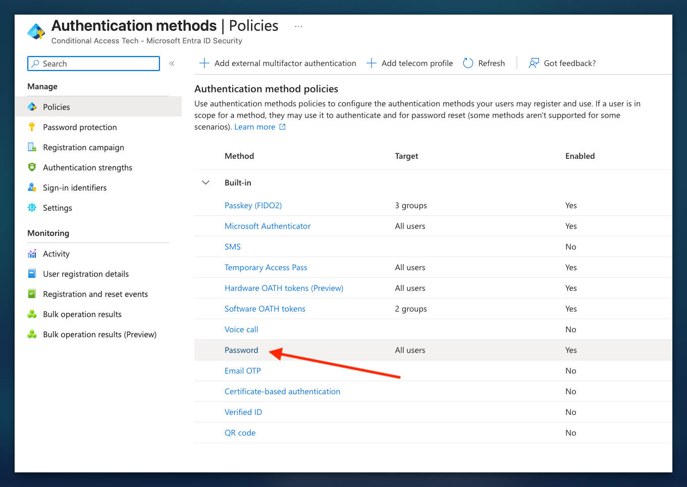

# Passkey Migration: A Practical Rollout Plan

01 · Context

## Why the clock is running

Passkeys have been a point of contention, and I feel strongly about them. Almost as strongly as Jan Bakker, though I think he's got me beat.

I remember working as an ops tech, going from office to office, and seeing what happened when people changed their passwords. They wrote them on sticky notes. Someone would tell me they used a password like Summer2019 and changed the season and year so they could remember it. Those predictable patterns make passwords easier for attackers to guess.

Passwords have always felt archaic to me. When FIDO2 offered an alternative built around the relying party ID and verification, I was all over it. FIDO2 and certificate-based authentication weren't new, but the term passkey confused people. I remember arguments with my own staff about synced passkeys, Bluetooth proximity and device-bound attestation. Once you understand the protocol and what it does, those things become clearer. It's our job as security and technology professionals to explain them.

Passkeys aren't perfect. I'll still die on the hill that they beat passwords and weak methods like SMS. A passkey does not make a compromised device safe, and the way you recover an account still matters.

When someone asks me how to get started, my answer is to start with yourself. Drink your own champagne. Your internal team will find the gaps before your clients do.

That's how I learned the chicken-and-egg problem. Require phishing-resistant authentication for admins. Good. Now how does an admin register a passkey? Plan a separate registration policy and a custom bootstrap strength that permits a Temporary Access Pass. Issue a TAP and test registration before enforcing the rest. Then you might find Authenticator registration blocked by an app protection or device policy. Review the affected policy and the Credential Registration resource; an exclusion may be needed. Test the combined policies rather than assuming one change fixes every flow.

I started by creating groups around personas. My [Entra baseline on GitHub](https://github.com/Jhope188/LearnGraphAPI/tree/main/Baseline/Entra) goes deeper into that process. I began with separate admin accounts and highly privileged roles. You *do* separate your daily account from your admin account, right? Get the authentication methods and passkey profiles in place, then build policies that match the people and resources. Licensing will affect which controls you can use.

I used PIM and required phishing-resistant authentication for elevated roles, Azure access and sensitive SharePoint data. Then I found the gaps: servers, RADIUS and other technologies that didn't work with the same passkey flow. Some needed a different authentication path. Others needed a documented workaround while we planned a replacement.

I moved the office over gradually, learned from the mistakes and took a tested process to clients. That's the playbook behind this guide. Passkeys have evolved, and people like Jan and Nate have shared work that helped. I want to collect those lessons here so you can find your own gaps sooner.

### Why now

Microsoft is making passkeys the default MFA experience for users who rely on SMS or voice. Passkey profiles and synced passkeys went GA in the first half of 2026, and existing configurations were migrated to a Default profile. Check what that profile allows before assuming it matches your admin requirements.

Passkeys are phishing-resistant because the sign-in is bound to the legitimate site or application. That helps stop an attacker collecting a credential through a lookalike sign-in page, but it does not stop an attacker using an already stolen session.

[Nate Hutchinson's passkey rollout guide](https://natehutchinson.co.uk/post/phishing-resistant-mfa-planning-your-passkey-rollout-in-microsoft-365/) is a useful companion to this one. His discussion of profile choices, legacy access and weaker fallback methods helped shape the decisions covered below.

| Date | What changed | Source |
| --- | --- | --- |
| Mar 2026 | Passkey profiles and synced passkeys GA (Worldwide, GCC) for tenants with Passkeys (FIDO2) enabled | MC1221452 |
| May to Jun 2026 | Existing config auto-migrated into the Default passkey profile (Worldwide, GCC; GCC High and DoD follow in Feb 2027). Attestation on means device-bound only; attestation off means device-bound and synced | MC1221452 |
| 1 Sep 2026 | Users enabled for SMS or voice are auto-enabled for passkeys and prompted at next MFA sign-in (public cloud) | Microsoft Security Blog |
| Nov 2026 to Jan 2027 | Passkey allowed as a user's first sign-in method (synced, Entra passkeys on Windows, FIDO2 keys). Authenticator passkeys follow in phase 2 | MC1450133 |
| 1 Feb 2027 | Microsoft-provided SMS and voice retirement begins for most users, phased per tenant. Keeping SMS or voice means bringing your own telecom provider | Microsoft Security Blog, MC1540327 |
| 1 Jul 2027 | Retirement begins for Global Administrators and external users | MC1540327 |

> ⚠️ Check this first Opting in to passkey profiles cannot be reversed, and the auto-migration carried your old attestation setting over. Open Entra ID > Authentication methods > Policies > Passkey (FIDO2) and confirm what your Default profile allows today before you design anything else.

Source: [MC1221452](https://mc.merill.net/message/MC1221452)· [Passkeys are the default (Microsoft Security Blog)](https://microsoft.com/en-us/security/blog/2026/07/13/microsoft-entra-id-security-updates-passkeys-are-the-default-authentication-method-in-entra-id/)· [MC1450133](https://entradiff.merill.net/message-center/MC1450133/)

02 · Discovery

## Inventory every account before you touch a policy

You cannot pick profiles until you know who is in the tenant and what they authenticate with today. Pull the registration state for every user, then sort them into buckets. The buckets become your groups, and the groups become your waves.

```
# Microsoft Graph PowerShell: who has what registered
Connect-MgGraph -Scopes "AuditLog.Read.All","UserAuthenticationMethod.Read.All"
Get-MgReportAuthenticationMethodUserRegistrationDetail -All |
  Select-Object UserPrincipalName, IsAdmin, IsPasswordlessCapable,
         IsMfaRegistered, @{Name="MethodsRegistered";Expression={$_.MethodsRegistered -join ";"}},
         UserType |
  Export-Csv .\auth-inventory.csv -NoTypeInformation
```

The registration report is a starting point, not a complete account inventory. Reconcile it with your user directory, PIM assignments and sign-in logs; a registered method does not prove that a user has used it or that a particular sign-in environment supports it.

| Bucket | How to find them | Passkey path |
| --- | --- | --- |
| Privileged admins | IsAdmin = true, PIM eligible and active assignments | Device-bound, attested. Wave 1 |
| High-risk targets | C-suite, finance, HR, exec assistants, anyone in recent phishing incidents | Device-bound. Wave 2 |
| Standard users | Everyone else with a mailbox and a phone | Synced or device-bound. Wave 3 |
| SMS / voice only | Review MethodsRegistered for phone methods and confirm which are usable for MFA | Priority comms. Microsoft-provided SMS and voice retirement starts 1 Feb 2027 |
| Guests (B2B) | UserType = Guest, split internal vs external | Now in scope. Rolling out by default to guests already targeted by your passkey policy. Decide before it reaches them (see below) |
| Break-glass | Your two emergency access accounts | FIDO2 security keys, stored separately |
| Shared and service | Shared mailboxes, kiosk, frontline shared devices, service accounts | Separate design. Workload identities do not use passkeys |

> ⚠️ B2B passkeys: MC1459133 Guests can now register a passkey issued by your tenant to meet your MFA requirements when you do not trust their home tenant's MFA. It is GA and on by default for guests already in scope of your Passkey (FIDO2) policy. Internal guests get it from late October to late November 2026, including Authenticator passkeys. External B2B users follow on a date Microsoft has not announced, and will not get Authenticator passkeys. Guests can register at My Security Info, through a sign-in prompt or through a registration campaign. If you do not want this, exclude guests in the authentication methods policy and remove SMS and voice for them too: guests who still have SMS or voice are auto-enabled for passkeys anyway. If cross-tenant access already trusts their home tenant's MFA, a FIDO2 credential from their home tenant keeps satisfying your authentication strength and nothing changes for them. Microsoft's table names FIDO2 security keys; it does not say whether a synced passkey counts, so test that with a partner. Microsoft Learn still lists guests as unable to register, so expect the docs to catch up.

| Guest type | What it is | B2B passkeys |
| --- | --- | --- |
| Internal guest | Local account in your tenant with UserType = Guest, credentials held by you | Rolling out late Oct to late Nov 2026, including Authenticator passkeys |
| External guest | B2B collaboration user signing in with their home tenant or social identity; you hold only the guest object | Date not announced. No Authenticator passkeys |

> ℹ️ External guests: check the B2B relationship first For partner organisations whose people already sign in with passkeys at home, trusting their MFA may avoid a second registration in your tenant. Review Entra ID > External Identities > Cross-tenant access settings > Inbound access > Trust settings for each partner. MFA trust and compliant-device trust are separate decisions: enable them only after reviewing the partner's controls and your access requirements. Without MFA trust, an external user must satisfy the resource tenant's MFA requirements with a method available there. Without device trust, a partner's compliance claim alone will not satisfy your compliant-device requirement. Test each guest scenario and authentication strength before enforcing it.

Source: [Plan phishing-resistant passwordless](https://learn.microsoft.com/en-us/entra/identity/authentication/how-to-plan-prerequisites-phishing-resistant-passwordless-authentication)· [Enable passkeys (FIDO2): known issues](https://learn.microsoft.com/en-us/entra/identity/authentication/how-to-enable-passkey-fido2)· [MC1459133: B2B passkeys](https://mc.merill.net/message/MC1459133)

03 · Design

## Two profiles: synced vs device-bound

Passkey profiles let you define configurations and target them at groups. My default is attested, device-bound passkeys for all users. Synced passkeys are available only when I intentionally add someone to the group assigned my separate synced profile. That follows the device-bound-first approach Nate describes. The Profile A and Profile B example later in this section is a different option, not my configuration.

My portal shows support for up to 10 profiles, while Microsoft's documentation currently says three, including the Default. Check the limit in your tenant before planning around either number.

> ℹ️ Useful reference Jan Bakker's Microsoft 365 Passkey Guide compares device-bound and synced storage options and links to an AAGUID explorer and registration campaign simulator. Use it when choosing what to support, then confirm the current requirements in Microsoft Learn.

### How I configured mine

In the Entra admin center, go to Entra ID > Authentication methods > Policies > Passkey (FIDO2), then open **Configure**. I have self-service setup enabled so users can register through Security info. That setting applies to the policy, not an individual profile.


*My Configure tab: the Default and Device-Bound profiles use attestation and key restrictions; Synced-Passkey allows synced passkeys without either.*

My **Default passkey profile** and **Device-Bound** profile both show attestation enabled, device-bound passkeys and key restrictions enabled. The screenshot does not show the actual allowed AAGUIDs, so open each profile and review its list. My **Synced-Passkey** profile allows synced passkeys, with attestation and key restrictions off. The warning icon is visible, but check the portal's warning text before assuming what it means.

To reproduce the design, use **Add profile** on the Configure tab, choose the passkey type, set attestation and key restrictions for your requirements, then save. For an attested device-bound profile, select approved authenticator AAGUIDs after checking vendor support. For a synced profile, disable attestation and select Synced. Test registration with the actual providers and devices you intend to support.


*My Enable and target tab: the default applies to all users, with separate synced and device-bound group assignments.*

Under **Enable and target**, I enabled the method and assigned the device-bound Default profile to All users. Users must be intentionally added to my SG-Entra-AUG-MFA-AuthPasskey group to receive Synced-Passkey as well. My SG-Entra-AUG-CAP-BreakglassAccounts group gets the separate Device-Bound profile. Use **Add target** to add a group and select its profile, then save and test with representative users.

> ⚠️ Watch the overlap All users receive the Default profile as well as any profile assigned through group membership. A passkey satisfying any assigned profile can be allowed; the more restrictive profile does not override the other. Check the effective memberships of privileged and emergency accounts, and test registration and sign-in. A passkey-method assignment is separate from your emergency-access Conditional Access exclusions and recovery plan.

### An alternative for standard users

The following Profile A and Profile B design is an alternative, not a description of the synced-only profile shown in my screenshot. Profile B allows both device-bound and synced passkeys for standard users.

Profile A

### Device-bound, attested

For admins, privileged roles and high-risk targets. The private key never leaves the device or key.

- Enforce attestation: **Yes**
- Passkey types: **Device-bound**
- Key restrictions: **Allow** list with Microsoft Authenticator AAGUIDs plus your approved FIDO2 key models
- Methods: Authenticator passkey or FIDO2 security key

Profile B

### Device-bound + synced

For standard users. Lets people use the passkey provider already on their phone, so adoption is faster and lost-phone tickets drop.

- Enforce attestation: **No** (synced passkeys cannot attest)
- Passkey types: **Device-bound and Synced**
- Key restrictions: optional, see the warning below
- Methods: Apple Passwords, Google Password Manager, third-party managers, Authenticator, keys

### Device-bound first or a broader synced option

My configuration follows Nate's device-bound-first approach: the default applies to everyone, and synced passkeys require deliberate membership in the synced group. The Profile A and B example above is an alternative that allows synced passkeys more broadly for standard users. Choose the approach that fits your requirements, with a tested recovery process and a clear owner for exceptions.

Both designs depend on profile overlap. Profiles combine as an OR, so a user in the device-bound and synced groups can register a method allowed by either. Conditional Access controls which methods can satisfy a particular resource's strength; test registration and sign-in separately. With attestation off, an AAGUID allow list cannot prove that the claimed provider or key type is genuine.

For synced passkeys, review the security and recovery of the provider account as well as the Entra account. A synced passkey may be available on more than one device, depending on the provider. For privileged users, I would keep the attested device-bound profile and test its enforcement rather than relying on an exception group alone.

### Can you lock synced passkeys to one provider?

Partly. You can add AAGUIDs for iCloud Keychain, Google Password Manager or 1Password to an allow or block list, but Microsoft is explicit that with attestation disabled, AAGUID lists are a policy guide, not a strict security control. The AAGUID is self-reported by an unattested authenticator. Treat a synced allow list as steering for honest users, not as a boundary. If the provider genuinely matters for a group, that group belongs in Profile A.

| Synced provider | Minimum platform | Status |
| --- | --- | --- |
| Apple Passwords (iCloud Keychain) | macOS 13+, iOS 16+ | Supported |
| Google Password Manager | Android 9+ (not Samsung devices), Chrome on Windows / macOS / iOS 17+ | Supported |
| 1Password, Bitwarden, other providers | Browser extension on Windows / macOS, app on iOS 17+ or Android 14+ | Supported |
| Microsoft Edge / Microsoft Password Manager | Work-account passkey sync announced for June 2026; not in Microsoft's Entra provider table | Test first |

> ℹ️ Authenticator version floor If a profile allows both device-bound and synced passkeys and targets Authenticator, users need Authenticator iOS 6.8.37 or Android 6.2507.4749 or later. Plan updates for managed and unmanaged devices before rollout.

> ⚠️ Turning synced off later Removing Synced from a profile blocks sign-in with every synced passkey already registered under it. Decide per group up front instead of tightening after go-live.

> ℹ️ Microsoft's own position The passkey FAQ says it directly: device-bound passkeys for admins and highly privileged users, synced passkeys for everyone without admin permissions. It also notes that admins cannot see or control which devices hold a copy of a synced passkey.

### Where Windows Hello and Platform SSO fit

Windows Hello for Business is a device-bound credential that can satisfy the Phishing-resistant MFA strength. Passkey profiles do not govern it: plan its own authentication method and Windows Hello for Business device policy, including Intune or Group Policy settings. Platform SSO outcomes depend on its configuration and the claims presented: test the actual sign-in and Conditional Access result rather than counting every enrolled Mac as complete. Windows Hello for Business remains Microsoft's recommended method on supported Entra joined or registered PCs.

Plan the first sign-in on a new Windows device too. Microsoft's provisioning flows can start with a password followed by MFA before a Windows Hello for Business credential exists. A TAP can bootstrap passwordless setup when the applicable policies allow it. Test new-joiner and replacement-device enrollment before enforcing passkey-only grants.

For hybrid users accessing on-premises resources, Microsoft recommends [cloud Kerberos trust](https://learn.microsoft.com/en-us/windows/security/identity-protection/hello-for-business/deploy/hybrid-cloud-kerberos-trust) over key trust, and prefers it when certificate authentication is not needed. It does not require certificate deployment for this trust model. Entra issues a partial Kerberos ticket-granting ticket and a domain controller completes it for on-premises access. Microsoft explains the flow for [Entra joined](https://learn.microsoft.com/en-us/windows/security/identity-protection/hello-for-business/how-it-works-authentication#microsoft-entra-join-authentication-to-active-directory-using-cloud-kerberos-trust) and [hybrid joined](https://learn.microsoft.com/en-us/windows/security/identity-protection/hello-for-business/how-it-works-authentication#microsoft-entra-hybrid-join-authentication-using-cloud-kerberos-trust) devices. Check the Windows Server 2016 or later domain controller versions, updates and other prerequisites in Microsoft's deployment guide. RDP and certificate scenarios still need their own design, covered in section 08.

Entra passkey on Windows is a separate thing: a device-bound passkey stored in the local Windows Hello container, aimed at devices that are not joined or registered. It does not sign the user in to Windows, registration fails if a Windows Hello for Business credential already exists for that account, and its profile cannot enforce attestation. That last point means it cannot live in Profile A. If you want it, plan a separate profile with the Windows Hello AAGUIDs on an allow list and check the profile limit in your tenant.

Source: [Enable passkeys (FIDO2) and passkey profiles](https://learn.microsoft.com/en-us/entra/identity/authentication/how-to-enable-passkey-fido2)· [Passkeys (FIDO2) concept](https://learn.microsoft.com/en-us/entra/identity/authentication/concept-authentication-passkeys-fido2)· [Windows Hello for Business provisioning](https://learn.microsoft.com/en-us/windows/security/identity-protection/hello-for-business/how-it-works-provisioning)· [Windows Hello for Business deployment planning](https://learn.microsoft.com/en-us/windows/security/identity-protection/hello-for-business/deploy/)· [Edge passkey sync for business (Borncity)](https://borncity.com/news/microsoft-edge-passkey-synchronisation-kommt-fuer-unternehmen/)

04 · Build

## Start with authentication methods and groups

Build the groups before the profiles, and the profiles before Conditional Access. The proposed group names below follow my SG-Entra-AUG convention and illustrate the alternative Profile A and B design from section 03; they are examples, not a list of my existing groups. In my own configuration, the Default is device-bound for all users and the synced group is assigned intentionally. Review exclusions carefully: excluding someone who still needs passkeys can block registration and sign-in with existing passkeys, while Microsoft's SMS and voice automatic enablement may affect eligible users separately.

| Group | Profile | Wave |
| --- | --- | --- |
| SG-Entra-AUG-MFA-Passkey-Pilot-IT-A and SG-Entra-AUG-MFA-Passkey-Pilot-IT-B | Separate pilot groups for Profiles A and B | 0 |
| SG-Entra-AUG-MFA-Passkey-Privileged | A: device-bound, attested | 1 |
| SG-Entra-AUG-MFA-Passkey-HighRisk | A: device-bound, attested | 2 |
| SG-Entra-AUG-MFA-Passkey-Users-Pilot then SG-Entra-AUG-MFA-Passkey-Users | B: device-bound and synced | 3 |
| SG-Entra-AUG-CAP-Passkey-PasswordAllowed | Temporary exclusion from the migration CA policy; not a password enablement control | Shrinks each wave |

A user in several profiles passes if their passkey satisfies at least one of them. That means an admin who is also in SG-Entra-AUG-MFA-Passkey-Users can register a synced passkey through Profile B. Keep Profile A groups out of Profile B, or enforce the difference with authentication strengths in Conditional Access.

### The group you want to empty: password still allowed

A temporary exclusion group can track users not yet in scope of the phishing-resistant policy. Remove each wave after testing, and report the remaining membership alongside registration and sign-in results. An empty group is a useful milestone, not proof that passwords are disabled.

The group can serve as a temporary exclusion from a Conditional Access policy requiring phishing-resistant authentication. Removing a user brings them into scope; it does not disable their password or prove that every sign-in path is covered. Review policy scope, other exclusions, guest access and legacy authentication separately, and test the actual sign-in outcomes before treating the group count as a migration measure.

An empty group does not make an Active Directory password unusable on-premises. Passkeys and an Entra Conditional Access policy do not by themselves disable AD password authentication for domain sign-ins, Kerberos or NTLM access to file shares and legacy apps. Assess controls such as requiring a smart card for interactive logon or a separately planned password-randomisation project, with testing and recovery for the affected accounts and services.

> ⚠️ Not on the Password row The Password method now opens in the Authentication methods policy, but its Enable and target tab cannot be changed: the portal states that password "is a built-in authentication method and is always enabled." You cannot scope it to this group. Enforce through Conditional Access and use the group as the exclusion. The Password method's Configure tab does hold one setting you want later, covered in section 09.


*Password > Configure: I enabled Allow password change after secure sign-in. This setting does not disable password authentication; revisit its tenant-wide impact in section 09.*


*Authentication methods > Policies in the conditionalaccess.tech tenant. Password is targeted at All users and cannot be retargeted.*

```
// Successful sign-ins with a password authentication step
SigninLogs
| where TimeGenerated > ago(7d) and ResultType == 0
| mv-expand AD = todynamic(AuthenticationDetails)
| where tostring(AD.authenticationMethod) == "Password"
| summarize PasswordSignIns = count(), LastSeen = max(TimeGenerated)
          by UserPrincipalName
| order by PasswordSignIns desc
```

Compare the results with the group and the Conditional Access results. This query does not check membership or prove a policy gap: a sign-in may include a password step and also satisfy a required strength.

- Opt in to passkey profiles (one-way) and set Allow self-service set up = Yes. It is global, and No stops all Security info registration
- Enable Temporary Access Pass and set the policy before Wave 0
- Check the registration campaign. Microsoft-managed campaigns now prompt for passkeys during MFA registration; set it to Enabled or Disabled if you want to control timing yourself
- Check Authentication methods > Settings > System-preferred authentication, including group exclusions; Microsoft managed is the default and covers first and second factors. Review [Microsoft's current authentication method order](https://learn.microsoft.com/en-us/entra/identity/authentication/concept-system-preferred-authentication#how-does-system-preferred-authentication-determine-the-most-secure-method)
- Remember the policy has a 20 KB size limit if you add many AAGUIDs
- Check licensing: passkey registration is free in every Entra edition, Conditional Access and account recovery need Entra ID P1, PIM and risk-based policies need P2

Source: [Enable passkeys (FIDO2)](https://learn.microsoft.com/en-us/entra/identity/authentication/how-to-enable-passkey-fido2)· [MC1450133](https://entradiff.merill.net/message-center/MC1450133/)

05 · Rollout

## Rollout waves: admins first, users last

Admins go first because they are the highest-value target and the most capable group to hit the bugs. If your Global Admins cannot get through a passkey registration, your finance team will not either, and you want to find that out with people who can read a sign-in log. The profile labels here follow the alternative A and B design; with my device-bound-first configuration, keep standard users on the default and add only approved users to the synced group.

WAVE 0

#### IT pilot

5 to 15 people. Every OS you support, at least one Android work-profile device and one Samsung.

Both profiles

WAVE 1

#### Admins and privileged roles

Everyone with an Entra role, PIM eligibility or Azure owner rights. Authenticator passkey or FIDO2 key.

Profile A

WAVE 2

#### High-risk targets

C-suite, finance, HR, exec assistants and delegates. Ship hardware keys to execs who travel.

Profile A

WAVE 3

#### Standard users

Pilot department first, then production in batches sized to your help desk.

Profile B

### Every wave runs the same cycle

**Day -7**CA policy created in report-only for the wave group

**Day -7 to 0**Registration open, TAPs issued, comms sent

**Day -2**Review report-only failures, fix gaps, move the date if needed

**Day 0**Policy on. Help desk staffed

**Day +7**Remove weaker methods for that group

Source: [Plan phishing-resistant passwordless](https://learn.microsoft.com/en-us/entra/identity/authentication/how-to-plan-prerequisites-phishing-resistant-passwordless-authentication)· [Microsoft 365 passkeys not working (T-Minus365)](https://tminus365.com/microsoft-365-passkeys-not-working/)

06 · Enforce

## Conditional Access in report-only, one week per wave

Report-only is your impact model. Build the enforcement policy for each wave at least a week before the go-live date, then investigate the results, including interrupted evaluations. A failure can point to an unregistered method, an incompatible app or a policy configuration issue. Adjust the timeline from what you find, not the other way round.

### Use authentication strengths, not "Require MFA"

The built-in **Phishing-resistant MFA** strength lists FIDO2 security key, Windows Hello for Business or platform credential, and certificate-based authentication (multifactor). Passkeys are covered by the FIDO2 category. For Profile A groups, consider a custom strength that allows only approved Passkeys (FIDO2) AAGUIDs. Test both registration and sign-in: AAGUID restrictions without attestation are not a strict security boundary, and enabling attestation later does not retroactively attest existing registrations.

Conditional Access evaluates the strength after initial authentication. If a user signs in to Windows with a password, Windows Hello for Business is not the primary sign-in claim and cannot simply be prompted as a second factor. Microsoft says to restart the session, choose **Sign-in options** and use a method the strength accepts. For a Windows Hello for Business sign-in, choose the PIN or biometrics. Include password-started Windows sessions in report-only testing; do not assume unlocking alone replaces the original sign-in claim.

### Preferred is not enforced

Check system-preferred authentication and its scope for the users in your pilot. The default, **Microsoft managed**, applies to first and second factors; the explicit **Enabled** setting applies to the second factor only. Users can still choose another allowed method. If an authentication strength also accepts push or OTP, someone who can use that weaker method may take that route instead. Nate calls out this downgrade risk: for sensitive resources, require a phishing-resistant strength that excludes those fallbacks and test it across supported apps and devices.

Microsoft's [current method order](https://learn.microsoft.com/en-us/entra/identity/authentication/concept-system-preferred-authentication#how-does-system-preferred-authentication-determine-the-most-secure-method) lists TAP first and passkey second. The order can change, and the prompt depends on registered methods, the device and browser.

System-preferred authentication does not override Conditional Access. A strength protects only the resources, users and sign-in paths covered by the policy, and a previously satisfied requirement can sometimes be reused in a session. Registration and recovery policies may need different, tightly scoped grants: document those exceptions rather than treating a preferred prompt as proof of enforcement.

### Split desktop and mobile, protect registration separately

Jan Bakker's baseline, and Microsoft's own workaround, both land in the same place. A single "require passkey" policy on All resources creates a registration loop. Split it.

| Policy | Target | Grant |
| --- | --- | --- |
| Register security info | User action: Register security information | Bootstrap strength: TAP (one-time or multi-use) or password + Authenticator push |
| Passkey: desktop | All resources, any platform except iOS and Android | Phishing-resistant strength |
| Passkey: mobile | All resources, iOS and Android | Passkey in Authenticator or TAP. Must match the registration policy grant |
| Admins | Directory roles, Azure management, PIM auth context | Custom device-bound strength |

These are example policies, not independent guarantees. Conditional Access policies combine, so test the full set together, especially admin policies that also target registration or mobile sign-in. The mobile policy permits TAP for app access as well as registration when no other policy blocks it. Treat that as a deliberate bootstrap exception, issue TAPs only when needed and keep their lifetimes short. Keep your emergency access plan outside the rollout group.

### Read the report-only results

```
// Log Analytics: who would be blocked by report-only passkey policies
SigninLogs
| where TimeGenerated > ago(7d)
| mv-expand CA = ConditionalAccessPolicies
| where tostring(CA.displayName) startswith "PK-"
| where tostring(CA.result) in ("reportOnlyFailure", "reportOnlyInterrupted")
| summarize Attempts = count(), Apps = make_set(AppDisplayName),
            OS = make_set(tostring(DeviceDetail.operatingSystem))
          by UserPrincipalName, Policy = tostring(CA.displayName)
| order by Attempts desc
```

Replace PK- with the prefix used by your Conditional Access policy names. The group names in section 04 are examples, not the policy names this query searches. No Log Analytics workspace? The Conditional Access insights and reporting workbook and the sign-in log filter on report-only result let you review results per policy.

Source: [You shall not pass(key)! (Jan Bakker)](https://janbakker.tech/you-shall-not-passkey-updated/)· [Support passkeys in Authenticator](https://learn.microsoft.com/en-us/entra/identity/authentication/how-to-support-authenticator-passkey)· [Authentication strength limitations](https://learn.microsoft.com/en-us/entra/identity/authentication/concept-authentication-strengths)· [Custom authentication strengths with AAGUIDs](https://learn.microsoft.com/en-us/entra/identity/authentication/how-to-enable-passkey-fido2)

07 · Onboard

## Registration: TAP, campaigns and where users start

For Authenticator passkeys, starting in the phone app is a useful way to avoid cross-device registration problems. Microsoft supports attested cross-device registration on Android; on iOS, attested passkeys must be registered directly in Authenticator. Test your supported browsers, devices and Conditional Access policies before choosing a single path for users.

| TAP setting | Default | Recommendation |
| --- | --- | --- |
| Default lifetime | 1 hour | 1 to 8 hours for scheduled onboarding sessions |
| One-time use | False | Leave multi-use available. One-time passes give users 10 minutes and caused loops in Jan Bakker's testing |
| Length | 8 | 8 is fine, the pass is short-lived |
| Who can issue | Authentication Administrator for users, Privileged Authentication Administrator for admins |  |

> ℹ️ Bootstrap flow Issue a TAP, have the user add their work account in Authenticator, sign in with the TAP and register the passkey in the app. Test the complete flow against your registration and app-access policies; a TAP must be permitted by the applicable authentication strength.

> ⚠️ Interrupt-mode trap Microsoft's TAP limitations say that users in scope of an SSPR or Identity Protection MFA registration policy are redirected to interrupt-mode registration after signing in with a TAP in a browser. That experience does not currently support FIDO2 or phone sign-in registration. Have those users register a passkey inside the Authenticator app or through supported manage-mode registration, or review the registration-policy scope while they onboard. Test the complete flow before changing protection.

Source: [Temporary Access Pass](https://learn.microsoft.com/en-us/entra/identity/authentication/howto-authentication-temporary-access-pass)· [You shall not pass(key)! (Jan Bakker)](https://janbakker.tech/you-shall-not-passkey-updated/)· [Support passkeys in Authenticator](https://learn.microsoft.com/en-us/entra/identity/authentication/how-to-support-authenticator-passkey)

08 · Troubleshoot

## Common blockers

Start with the Conditional Access tab in the sign-in log, then check the device, browser and registration flow.

### Do not overlook legacy access

Inventory VPNs, remote desktop gateways, Wi-Fi and other RADIUS or NPS-backed flows alongside your cloud apps. A passkey policy for an Entra-connected app does not by itself prove that a separate legacy sign-in path is protected by the same strength. Test each path end to end, record its supported methods and owner, and agree compensating controls and an expiry date for exceptions.

Where suitable, assess moving an on-premises application behind [Microsoft Entra Private Access](https://learn.microsoft.com/en-us/entra/global-secure-access/concept-private-access) or another modern authentication path. Validate application, client and licensing compatibility before assuming that a gateway or RADIUS workflow can be replaced.

### Servers and RDP: which sign-in are you trying to protect?

There are two separate tests: signing in to establish the remote desktop connection, and using a passkey in an app *inside* an existing session. A green result for one does not prove the other works. The local OS, remote desktop client, target OS and join state all matter. Microsoft publishes a [remote desktop support matrix](https://learn.microsoft.com/en-us/entra/identity/authentication/how-to-plan-rdp-phishing-resistant-passwordless-authentication); check it against the versions and configuration you actually run.

| Path | What to test |
| --- | --- |
| Entra-connected server | Microsoft lists FIDO support for session initiation on Entra joined or hybrid joined Windows Server 2022 and later, subject to client and tenant requirements. For Arc-managed standalone/workgroup servers, the matrix requires Entra join and Windows Server 2025 or later. Test your actual RDP client and target configuration. |
| Azure VM with Entra sign-in | For Entra-authenticated VM sign-in, a policy targeting Microsoft Azure Windows Virtual Machine Sign-in can require phishing-resistant MFA. A client unable to satisfy the strength can receive “The sign-in method you're trying to use isn't allowed.” For the documented passwordless web-account flow, check supported session hosts: Windows 11 with KB5018418 or later, Windows 10 20H2+ with KB5018410 or later, Server 2022 with KB5018421 or later, or Server 2025+. Other VM and client prerequisites apply. Locking this remote session disconnects it because the lock screen cannot use Entra tokens or FIDO keys; reconnect to trigger sign-in again. |
| AD-only server | Microsoft's matrix does not list FIDO for RDP session initiation or in-session FIDO on an on-premises domain-joined-only Windows Server. Entra-issued Kerberos SSO to supported on-premises resources does not automatically add passkey support to an RDP logon. |
| Passkey inside an existing session | WebAuthn redirection can send an in-session request to a supported local client. The client, host and redirection policy must all allow it. Microsoft's [Windows App feature matrix](https://learn.microsoft.com/en-us/windows-app/compare-platforms-features#redirection) lists preview support for Azure Virtual Desktop and Windows 365 on macOS 11.4.2+, iOS 11.3.7+ and Android 11.0.0.119+ (Windows App versions). It is limited to the listed Entra sign-in endpoints. On Android the passkey must be in a software provider on that device, such as Authenticator; external security keys and QR passkeys on another device are not supported. The older RDP planning matrix differs, so check both sources and test your exact target and versions. |
| Jump server or nested session | Do not assume the second hop redirects WebAuthn because the first one works. Test each hop and client. Microsoft notes that Windows Server jump servers can impede FIDO and recommends considering certificate-based authentication for that scenario. |

If Windows Hello for Business or Platform SSO is unavailable, check whether a supported FIDO2 security key attached to the local client or a local passkey can serve the specific Entra sign-in. For AD-backed RDP, a smart card or Windows Hello for Business with an appropriately deployed certificate and smart-card redirection may be an option. Microsoft's Azure VM guidance lists certificate trust, not key trust, for its credential-based Windows Hello for Business path; its troubleshooting text describes key trust differently. Verify the exact connection mode and current documentation. Certificate-based RDP needs PKI, client and server support; it is a separate design, not an automatic fallback. Test an alternative admin workstation or access path before taking the existing one away.

### The QR code is on my screen. Why does proximity fail?

A phone passkey's cross-device flow needs Bluetooth and internet on both the phone and the device actually handling the WebAuthn request. In a supported RDP session with WebAuthn redirection working, that request is handled on your local client, so the phone needs to be near *your laptop*, not the server in a datacenter. Confirm the prompt is redirected rather than assuming it is.

If the request stays on the remote machine, your phone can scan the QR code displayed through RDP but is not near the remote machine's Bluetooth radio. Scanning the code alone does not satisfy proximity. Use a supported redirection path or another supported credential; don't weaken an admin policy just to get past the prompt. For Azure Virtual Desktop, check both host policy and host-pool settings: a more restrictive setting can disable redirection.

### RADIUS and NPS are a different problem

Microsoft's NPS extension performs AD DS primary authentication and then invokes an Entra MFA second factor. Its documented methods depend on the RADIUS authentication protocol and include notifications and, where supported, verification codes; the flow is not a WebAuthn passkey prompt. The extension does not support number matching. TOTP and simple approval are not phishing-resistant, so record the exposure, restrict access and plan a supported migration rather than calling that path passkey-protected.

For each VPN, gateway or Wi-Fi service, identify whether it can use a modern Entra sign-in directly, whether certificate-based access is supported, or whether another vendor-supported approach is needed. A separate Entra Conditional Access policy on a cloud app is not evidence that the RADIUS exchange enforces the same authentication strength.

Nate recommends looking for these paths in Entra sign-in logs by filtering for a resource ID containing radius. Inspect the results and their Conditional Access tab: NPS extension events can show **Not applicable**. Use the logs alongside your gateway inventory, since the absence of a match does not prove that every RADIUS path is accounted for.

| Blocker | What happens | Fix |
| --- | --- | --- |
| OS too old | No passkey option in Authenticator | Authenticator passkeys need iOS 17+ or Android 14+. Use FIDO2 keys for devices you cannot upgrade |
| Android work profile | Passkey works in one profile only | Register one passkey per profile (Work and Personal) |
| Samsung + Google Password Manager | No native synced passkey | Use Authenticator or a FIDO2 key. Samsung Pass is not in Microsoft's supported list |
| MAM / app protection on All resources | "Require approved client app" or "Require app protection policy" blocks Authenticator registration | Scope the Conditional Access policies to specific apps, or exclude Microsoft Authenticator Credential Registration (6aa00308-ea33-4caa-90d6-ae905d8cb51b) once provisioned. Nate also describes excluding Microsoft App Access Panel, AAD Reporting and Azure Credential Configuration Endpoint from the app-protection Conditional Access policy. Assess the broader impact and test the registration flow before using those exclusions. |
| Require compliant device | Same-device enrollment in Authenticator breaks on unmanaged phones | Fully MDM-managed devices can satisfy it; BYOD needs the exclusion above |
| Cross-device QR fails | Laptop never sees the phone | Bluetooth and internet on both devices; allow cable.ua5v.com (Android) and cable.auth.com (iOS) |
| "Passkey not registered" | Password manager offered a synced passkey to a device-bound profile | Expected. User registers in Authenticator or on a key |
| Safari + attestation | Creation fails in Safari | Register in Authenticator directly on iOS |
| UPN change | Existing passkey stops matching | Delete and re-register |
| Attestation outage | Registration fails when Apple App Attest or Google Play Integrity is down | Retry later; nothing to fix in the tenant |

> ℹ️ New in November 2026 The Microsoft Authenticator Credential Registration resource must be provisioned as a service principal before you can exclude it ( POST /v1.0/servicePrincipals with its app ID). Excluding it does not satisfy a Register security information policy, so keep that policy's grant aligned.

Source: [Support passkeys in Authenticator](https://learn.microsoft.com/en-us/entra/identity/authentication/how-to-support-authenticator-passkey)· [Windows App redirection by platform](https://learn.microsoft.com/en-us/windows-app/compare-platforms-features#redirection)· [Entra sign-in to Azure Windows VMs](https://learn.microsoft.com/en-us/entra/identity/devices/howto-vm-sign-in-azure-ad-windows)· [Nate Hutchinson: passkey rollout](https://natehutchinson.co.uk/post/phishing-resistant-mfa-planning-your-passkey-rollout-in-microsoft-365/)· [Things to know before rolling out Authenticator passkeys (Jan Bakker)](https://janbakker.tech/things-you-should-know-before-rolling-out-device-bound-passkeys-in-microsoft-authenticator-app/)· [Passkeys not working (T-Minus365)](https://tminus365.com/microsoft-365-passkeys-not-working/)

09 · Harden

## After go-live: take away the fallbacks

Adding passkeys does not remove risks from weaker methods that remain available. Review which methods can satisfy each sensitive access policy, then retire fallbacks where users have a tested recovery path.

### Remove weaker methods

After each wave has a tested alternative and recovery path, remove SMS and voice where they are no longer needed, starting with Profile A groups. Microsoft's retirement starts on 1 February 2027 for most users and 1 July for Global Administrators and external users; both are phased rollouts. For admins, review push and OTP as well, and confirm the remaining paths meet your device-bound requirements.

### Make every elevation phishing-resistant

Map a PIM authentication context to the device-bound strength and test activation with your sign-in frequency settings. A previously satisfied requirement can be reused within a session. [Microsoft's guidance](https://learn.microsoft.com/en-us/entra/id-governance/privileged-identity-management/pim-how-to-change-default-settings) for requiring reauthentication on activation is to set **Sign-in frequency: Every time** on the Conditional Access policy targeting that context. A 10-minute window still applies: another role activation in that window is not prompted to reauthenticate again. Test this with your actual roles and apply appropriate controls for Azure management, admin security info registration and sensitive apps too.

> ⚠️ Users who cannot use passkeys Some sessions cannot do passkeys at all, and registering a passkey on another device does not fix the session that cannot. MC1540327 tells admins to give those users a compatible alternative before the retirement: Authenticator push, passwordless phone sign-in or an Authenticator TOTP code. Keep one of those for standard users who need it. Do not keep it for admins.

### Lock down registration

Once a group is live, tighten its Register security information policy so adding a new passkey needs a passkey or a TAP, not password plus push. Otherwise an attacker who phishes the weaker method registers their own passkey and you have upgraded them. Alert on new passkey registrations for Profile A users in the audit log.

Registration controls are only half the job. Monitor new authentication methods and make sure someone receives and investigates the alert. A registration event does not prove malicious activity, but an unexpected passkey on an admin account deserves a fast response. Check the audit and related sign-in logs, confirm the registration with the user through a trusted channel, and follow your incident process if they did not authorize it. Contain the account and sessions and remove the unauthorized method as appropriate, while preserving a safe recovery path.


*My Azure Monitor registration alert shows the affected account. The affected resource, resource group and alert rule ID are redacted. Check the audit event for passkey registration details.*

[Nathan McNulty's MFA registration notification samples](https://github.com/nathanmcnulty/research-passkeys/tree/main/samples/notifications) offer another approach: a Microsoft Sentinel analytics rule and Logic App notify the user when a supported authentication method is registered. Nathan's documentation also discusses a scheduled Graph-based alternative. The samples cover more than passkeys and have their own prerequisites and limitations; review them before deployment. They are separate from the Azure Monitor alert pictured above.

Test your detection with device-bound and synced passkey registrations: they can produce different audit events, and companion events can cause duplicate notifications. Confirm audit logs reach your monitoring destination, test the end-to-end notification, and decide who responds when a user reports a registration they do not recognize.

### Let passwordless users change their password without knowing it

Once a group has left the password-allowed group and is signing in with passkeys, most of those users will forget their password. That is the point, until some legacy app or on-premises resource asks for it. The fix is a new setting on the Password method, not SSPR.

| Setting | Detail |
| --- | --- |
| Where | Entra ID > Authentication methods > Policies > Password > Configure, tick Allow password change after secure sign-in. Graph beta: allowPasswordChangeAfterSecureSignIn on the Password method configuration |
| What it does | A user who signed in with a strong credential sets a new password in My Sign-Ins without entering the current one |
| User path | mysignins.microsoft.com/security-info/password/change |
| Strong credentials | MC1437671 lists passkey, FIDO2 security key and Windows Hello for Business. Jan Bakker's post lists passkey, certificate-based authentication and Authenticator passwordless phone sign-in. Test the methods you use |
| Default | Off |
| Scope | Tenant-wide. No user or group targeting |
| Rollout | GA, Worldwide and GCC, end of October to end of November 2026 |
| Licence | Entra ID P1 or P2 (per Jan Bakker) |
| Hybrid | Jan Bakker reports the new password is written back to Active Directory when password writeback is on. Microsoft has not documented this yet, so test with a synced user before you rely on it |


*Password > Configure: Allow password change after secure sign-in, enabled in my tenant.*

Evaluate it once your first wave is ready. The setting is tenant-wide, so review its impact on every user who can meet the strong-sign-in requirement before enabling it. It is not SSPR: users do not need to register for SSPR to use it.

### Turn off password expiration

Review password expiration against your organisation's policies, regulatory obligations and hybrid requirements. Where rotation is not required, Microsoft recommends avoiding periodic password changes without evidence of compromise; keep breached-credential detection and a tested response in place.

### Retire SSPR, replace it with account recovery

SSPR resets a password, so review whether each wave still needs it for legacy or hybrid access. Do not remove it until you have tested an alternative for users who lose their credentials. Microsoft Entra account recovery is one option: it uses an identity verification provider and Verified ID to issue a TAP for re-enrollment. Start in Evaluation mode, review the privacy implications and confirm licensing, provider costs, availability and hybrid requirements before relying on it.

> ⚠️ New phone season Device-bound Authenticator passkeys do not move to a new phone. If the user still has both phones, they may be able to use the existing passkey on the old phone to authenticate while registering a new passkey on the new phone, subject to device support and your registration policy. The new phone creates its own device-bound passkey; it does not copy the old one. Watch my phone-to-phone walkthrough , then test the new passkey before wiping the old phone. If the old phone is unavailable, use your tested recovery path, such as a TAP issued after identity verification. Synced passkeys follow the provider account, which is the main operational argument for Profile B.

Source: [Account recovery overview](https://learn.microsoft.com/en-us/entra/identity/authentication/concept-account-recovery-overview)· [SMS and voice retirement timeline](https://microsoft.com/en-us/security/blog/2026/07/13/microsoft-entra-id-security-updates-passkeys-are-the-default-authentication-method-in-entra-id/)· [Lost or replaced phones (T-Minus365)](https://tminus365.com/microsoft-365-passkeys-not-working/)· [MC1540327](https://mc.merill.net/message/MC1540327)· [Enable account recovery](https://learn.microsoft.com/en-us/entra/identity/authentication/how-to-account-recovery-enable)· [MC1437671](https://mc.merill.net/message/MC1437671)· [Allow password change after secure sign-in (Jan Bakker)](https://janbakker.tech/allow-password-change-after-secure-sign-in/)

10 · Run sheet

## Checklist

- Export registration details and bucket every account
- Confirm what the auto-migrated Default passkey profile allows
- Create groups: separate pilot groups for each profile, Privileged, HighRisk, Users-Pilot and Users
- Use a temporary migration exclusion group if needed, then remove users wave by wave; separately verify which sign-in paths and passwords remain usable
- Build Profile A (device-bound, attested, AAGUID allow list) and Profile B (device-bound + synced)
- Enable TAP, set lifetime, decide on one-time use
- Set registration campaign to the behaviour you want
- Provision the Authenticator Credential Registration service principal and review MAM / compliance policies on All resources
- Confirm Authenticator meets Microsoft's minimum version where you use a profile allowing both device-bound and synced passkeys. Plan updates for managed and unmanaged devices before rollout
- Create custom authentication strengths: bootstrap, phishing-resistant, device-bound admin
- Check system-preferred authentication, its group scope and [Microsoft's method order](https://learn.microsoft.com/en-us/entra/identity/authentication/concept-system-preferred-authentication#how-does-system-preferred-authentication-determine-the-most-secure-method); test that weaker methods cannot satisfy the enforced strength
- Inventory and test legacy, VPN and RADIUS paths; assign owners and review dates to exceptions
- Wave 0 pilot across every OS, including Android work profile and Samsung
- For each wave: report-only 7 days, review failures, go live, remove weaker methods
- Map PIM activation to the device-bound strength
- Test registration alerts for device-bound and synced passkeys, and agree who investigates unexpected registrations
- Turn on Allow password change after secure sign-in once the first wave is passkey-only
- Review password expiration and SSPR requirements; pilot and validate an account recovery path before removing existing options
- Brief help desk on lost-phone recovery before September device launches

11 · References

## Sources

| Source | Used for |
| --- | --- |
| [Enable passkeys (FIDO2)](https://learn.microsoft.com/en-us/entra/identity/authentication/how-to-enable-passkey-fido2) | Profiles, attestation, synced providers, version floors, known issues |
| [Support passkeys in Authenticator](https://learn.microsoft.com/en-us/entra/identity/authentication/how-to-support-authenticator-passkey) | AAGUIDs, CA loops, MAM, Credential Registration resource |
| [Temporary Access Pass](https://learn.microsoft.com/en-us/entra/identity/authentication/howto-authentication-temporary-access-pass) | TAP settings and limits |
| [Account recovery overview](https://learn.microsoft.com/en-us/entra/identity/authentication/concept-account-recovery-overview) | IDV, Verified ID, Evaluation mode |
| [Plan phishing-resistant passwordless](https://learn.microsoft.com/en-us/entra/identity/authentication/how-to-plan-prerequisites-phishing-resistant-passwordless-authentication) | Privileged-first, licensing, stakeholders |
| [Microsoft Security Blog, 13 Jul 2026](https://microsoft.com/en-us/security/blog/2026/07/13/microsoft-entra-id-security-updates-passkeys-are-the-default-authentication-method-in-entra-id/) | Passkeys default, SMS/voice retirement |
| [MC1221452](https://mc.merill.net/message/MC1221452) · [MC1450133](https://entradiff.merill.net/message-center/MC1450133/) · [MC1459133](https://mc.merill.net/message/MC1459133) | Profile GA and migration dates, first sign-in method, B2B guest passkeys |
| [Jan Bakker: You shall not pass(key)!](https://janbakker.tech/you-shall-not-passkey-updated/) | CA split, bootstrap strength, test matrix |
| [Jan Bakker: Microsoft 365 Passkey Guide](https://passkey.janbakker.tech/index.html) | Device-bound and synced passkey storage options |
| [Nate Hutchinson: Planning your passkey rollout in Microsoft 365](https://natehutchinson.co.uk/post/phishing-resistant-mfa-planning-your-passkey-rollout-in-microsoft-365/) | Device-bound-first alternative, app protection exclusions, downgrade risk and RADIUS discovery |
| [Nathan McNulty: MFA registration notifications](https://github.com/nathanmcnulty/research-passkeys/tree/main/samples/notifications) | Registration monitoring, user notifications and audit event coverage |
| [System-preferred authentication](https://learn.microsoft.com/en-us/entra/identity/authentication/concept-system-preferred-authentication) | Preferred prompts, method choice and Conditional Access |
| [Remote Desktop phishing-resistant support](https://learn.microsoft.com/en-us/entra/identity/authentication/how-to-plan-rdp-phishing-resistant-passwordless-authentication) · [Windows App feature comparison](https://learn.microsoft.com/en-us/windows-app/compare-platforms-features#redirection) · [WebAuthn redirection](https://learn.microsoft.com/en-us/azure/virtual-desktop/redirection-configure-webauthn) | RDP session initiation, in-session preview support and redirection policy |
| [Entra sign-in to Azure Windows VMs](https://learn.microsoft.com/en-us/entra/identity/devices/howto-vm-sign-in-azure-ad-windows) | VM Conditional Access, passwordless session hosts and remote lock behavior |
| [Plan Windows Hello for Business](https://learn.microsoft.com/en-us/windows/security/identity-protection/hello-for-business/deploy/) · [Cloud Kerberos trust](https://learn.microsoft.com/en-us/windows/security/identity-protection/hello-for-business/deploy/hybrid-cloud-kerberos-trust) · [Provisioning](https://learn.microsoft.com/en-us/windows/security/identity-protection/hello-for-business/how-it-works-provisioning) | Separate policy, hybrid trust options and new-device enrollment |
| [PIM role settings](https://learn.microsoft.com/en-us/entra/id-governance/privileged-identity-management/pim-how-to-change-default-settings) · [Combined registration](https://learn.microsoft.com/en-us/entra/identity/authentication/concept-registration-mfa-sspr-combined) | PIM reauthentication and interrupt-mode limitations |
| [Sign in with Authenticator passkeys](https://learn.microsoft.com/en-us/entra/identity/authentication/how-to-sign-in-passkey-authenticator) · [Windows Hello for Business RDP sign-in](https://learn.microsoft.com/en-us/windows/security/identity-protection/hello-for-business/rdp-sign-in) | Phone proximity and certificate-based RDP options |
| [NPS extension for Entra MFA](https://learn.microsoft.com/en-us/entra/identity/authentication/howto-mfa-nps-extension) | RADIUS authentication flow and supported second factors |
| [Jan Bakker: before rolling out Authenticator passkeys](https://janbakker.tech/things-you-should-know-before-rolling-out-device-bound-passkeys-in-microsoft-authenticator-app/) | Android, compliance and MAM gotchas |
| [T-Minus365: passkeys not working](https://tminus365.com/microsoft-365-passkeys-not-working/) | Failure modes, recovery steps |
| [Passkey FAQ](https://learn.microsoft.com/en-us/entra/identity/authentication/passkey-faq) | Device-bound for admins, synced for non-admins |
| [Entra passkey on Windows](https://learn.microsoft.com/en-us/entra/identity/authentication/how-to-authentication-entra-passkeys-on-windows) | Windows Hello container, attestation limit, AAGUIDs |
| [Authentication strengths](https://learn.microsoft.com/en-us/entra/identity/authentication/concept-authentication-strengths) · [external users](https://learn.microsoft.com/en-us/entra/identity/authentication/concept-authentication-strength-external-users) | What satisfies Phishing-resistant MFA, TAP, guest trust |
| [MC1540327](https://mc.merill.net/message/MC1540327) · [Enable account recovery](https://learn.microsoft.com/en-us/entra/identity/authentication/how-to-account-recovery-enable) | Phased SMS and voice dates, recovery licensing |
