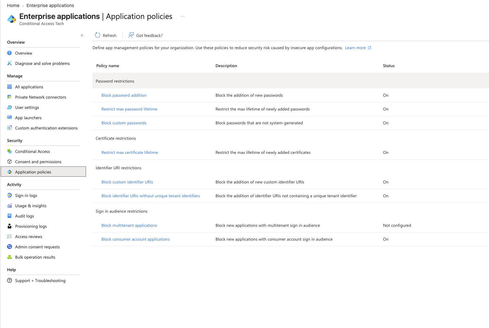

# App Registrations and Enterprise Apps: What the Entra object model actually looks like

*Entra Identity Platform · Architecture*

The blueprint vs the deployed instance, OAuth 2.0 and OIDC as protocol, how redirect URIs enforce security, and how one vendor credential compromise hit customer tenants across the MSP space.

Entra ID · OAuth 2.0 · OIDC · Security · · · Microsoft MVP · Security: Identity & Access

Part 01

## The Object Model: App Registration vs Enterprise App vs Service Principal

Source: [Application and service principal objects](https://learn.microsoft.com/en-us/entra/identity-platform/app-objects-and-service-principals) · [servicePrincipal resource type](https://learn.microsoft.com/en-us/graph/api/resources/serviceprincipal) · [Applications listed in Enterprise applications](https://learn.microsoft.com/en-us/entra/identity/enterprise-apps/application-list)

App registration, enterprise application and service principal get used interchangeably, and the Entra admin center doesn't help: it names the same objects differently depending on which blade you're in.

Start with the simplest mental model: an **App Registration** is the blueprint. An **Enterprise Application** is the deployed instance. The app registration is the parent: Microsoft describes it as the template or blueprint from which a service principal is created in every tenant that uses the app.

### App Registration (Application Object)

The global definition of the app. Lives in the home tenant. Describes what the app needs: permissions, redirect URIs, client secrets, certificate credentials. Globally unique across all Entra tenants via its `appId` (client ID). You own this.

### Enterprise Application (Service Principal)

The local representation of the app in a specific tenant. Controls who can access the app, what permissions are actually granted, and how assignment works. Created automatically when the app is registered, and in another tenant when that tenant consents to it. Exposed via `/servicePrincipals` in Graph.

"Service principal" is also the name of a category, which is a separate idea from that parent-child link. Microsoft's concept documentation defines three types of service principal: application, managed identity and legacy. An enterprise application is the application type, the one created from an app registration. The Enterprise apps blade defaults to the **Enterprise Applications** filter, which shows service principals tagged `WindowsAzureActiveDirectoryIntegratedApp`. Microsoft's Entra PowerShell documentation uses the same tag filter to list enterprise apps. A service principal created without that tag, for example from a script, only appears when you switch the filter to **All Applications**, which lists every service principal in the tenant.

The other two types have no app registration behind them. **Managed identities** (system or user-assigned) get a service principal in your tenant when the managed identity is enabled. There are no credentials for you to manage, and the service principal can be granted access but can't be modified directly. **Legacy** service principals represent apps created before app registrations existed, or through legacy experiences, and only work in the tenant where they were created.

If you query Graph, the `servicePrincipalType` property can also return two values the concept page doesn't list: `ServiceIdentity` for Entra Agent ID agent identities, and `SocialIdp`, which Microsoft marks as internal use.

> ℹ️ Key distinction on permissions The app registration defines what the developer says the app needs. The service principal defines what the tenant admin has actually allowed. They can differ. A multitenant SaaS app may request broad permissions in its registration, but your admin consent only grants a subset.

### The two object IDs you'll constantly confuse

| Property | Where it lives | What it is | Also called |
| --- | --- | --- | --- |
| `appId` | App Registration | Globally unique identifier for the app across all tenants | Client ID, Application ID |
| `id` (on the application object) | App Registration | Object ID of the registration within the home tenant | App object ID |
| `id` (on the service principal) | Enterprise App / SP | Object ID of this tenant's service principal instance | SP object ID, Enterprise app object ID |

When you write a Conditional Access policy and target an application, you're targeting the `appId`. When you assign Azure RBAC to a service principal, you're using the SP's `id`. These are different values, on different objects, in the same Graph resource set. Getting them swapped is a common source of automation bugs.

Part 02

## Single-Tenant vs Multi-Tenant: How the object relationship scales

Source: [Tenancy in Microsoft Entra ID](https://learn.microsoft.com/en-us/entra/identity-platform/single-and-multi-tenant-apps) · [Convert app to multi-tenant](https://learn.microsoft.com/en-us/entra/identity-platform/howto-convert-app-to-be-multi-tenant) · [Zero Trust: App Registration Best Practices](https://learn.microsoft.com/security/zero-trust/develop/app-registration#app-registration-best-practices) · [Microsoft: Plan SSO Integration for ISVs](https://learn.microsoft.com/entra/identity/enterprise-apps/plan-sso-integration-isv) · [Microsoft: Resource Isolation in a Single Tenant](https://learn.microsoft.com/en-us/entra/architecture/secure-single-tenant)

App registrations have a `signInAudience` property that determines which tenants can authenticate against the app. The value controls whether Entra creates service principals in external tenants when users from those tenants consent.

| signInAudience value | Who can authenticate | Service principals created |
| --- | --- | --- |
| `AzureADMyOrg` | Users in the home tenant only | One SP in the home tenant |
| `AzureADMultipleOrgs` | Any organizational Entra tenant | SP created in each tenant that consents |
| `AzureADandPersonalMicrosoftAccount` | Entra tenants + personal Microsoft accounts | SP per tenant; personal account auth uses the common endpoint |

For single-tenant apps, the registration and service principal are siblings in the same tenant. For multitenant apps, the registration stays in the home tenant, and a service principal is instantiated in every customer tenant that goes through admin consent or user consent. This is why Microsoft Defender for Cloud Apps has one app registration in Microsoft's home tenant but a distinct service principal in every customer tenant that onboards it.

Home Tenant (ISV)

App Registration

`appId: abc-123`

Client secrets

Redirect URIs

Permission definitions

→

Customer Tenant A

Service Principal

References `appId: abc-123`

Holds granted permissions

Controls user assignment

→

Customer Tenant B

Service Principal

Same `appId: abc-123`

Independent permissions

Independent assignment

The common Entra OAuth endpoint (`login.microsoftonline.com/common/oauth2/v2.0/authorize`) handles the cross-tenant routing. The app presents its `appId`, a user authenticates in their home tenant, and Entra routes the token issuance to the correct tenant's service principal. This is what allows a single credential set in the app registration to work across all customer tenants without the ISV managing per-customer secrets.

> ⚠️ Not all Enterprise Apps have an app registration in your tenant OIDC and OAuth 2.0 multitenant apps only land a service principal in your tenant. The application object already exists in the ISV's home tenant and is only referenced. SAML, Linked, Password SSO, and Application Proxy apps provision both an app registration and a service principal directly in your tenant, because there is no pre-existing home tenant app object to reference. The registration is created locally as part of the gallery or manual onboarding flow, and tenant-specific configuration (ACS URLs, signing certificates, token claims) is stored on that local object.

> ℹ️ **Microsoft guidance: the tension between scale and security:** The [Zero Trust app registration best practices](https://learn.microsoft.com/security/zero-trust/develop/app-registration#app-registration-best-practices) are explicit: "Define your application as a multi-tenant app only when necessary. Unless you intend to develop your app as a multitenant app, start with a `SignInAudience` value of `AzureADMyOrg`." A related page, [Secure resource isolation in a single tenant](https://learn.microsoft.com/en-us/entra/architecture/secure-single-tenant), makes the same argument one level up: "If possible, we recommend you delegate administration to separate environments in a single tenant." That page is about how an organization structures its own tenants rather than an app's sign-in audience, but the principle carries over. Fewer trust boundaries means less to defend. The [ISV SSO integration guide](https://learn.microsoft.com/entra/identity/enterprise-apps/plan-sso-integration-isv) pulls the other way: "For most SaaS ISVs, multitenant architecture is the recommended default" because it simplifies deployment and is required for Entra app gallery inclusion. The tradeoff: a single compromised credential in the ISV's home tenant carries blast radius across every customer tenant that consented. Single-tenant avoids that, but requires per-customer app registrations, a separate credential lifecycle per tenant, and loses gallery eligibility. Most ISVs pick multi-tenant because distribution pressure wins, and the guidance recommending otherwise rarely gets read.

Part 03

## Credential Model: Where client secrets and certificates actually live

Source: [Certificate credentials for app authentication](https://learn.microsoft.com/en-us/entra/identity-platform/certificate-credentials) · [passwordCredential resource type](https://learn.microsoft.com/en-us/graph/api/resources/passwordcredential) · [Security best practices for app registrations](https://learn.microsoft.com/en-us/entra/identity-platform/security-best-practices-for-app-registration) · [Mutable subjects in federated credentials](https://learn.microsoft.com/en-us/entra/workload-id/workload-identities-federated-credential-mutable-subjects)

Client secrets and certificates can be registered against either the application object or the service principal directly. Where the credential lives decides who can see it and which tenant it works in.

### Secret on the App Registration

Stored in `passwordCredentials` on the application object. Visible in the Entra portal under the app registration's "Certificates & secrets" blade. Works cross-tenant for multitenant apps. Required for multitenant SaaS. This is the standard approach.

### Secret on the Service Principal

Stored in `passwordCredentials` on the service principal object. Not visible anywhere in the Entra portal. Manageable only via Graph API or PowerShell. Only works for sign-ins to that tenant, and rare in practice.

Both authenticate successfully. Both produce the same resulting token when used in a client credentials flow. The difference is visibility: service principal secrets are invisible in the portal, which creates an audit blind spot. Credentials you can't see in the portal are easy to miss during rotation and during incident response.

> ℹ️ Microsoft's [app registration security guidance](https://learn.microsoft.com/en-us/entra/identity-platform/security-best-practices-for-app-registration#credentials-including-certificates-and-secrets) ranks credentials like this: Certificates (`keyCredentials`) follow the same placement rules as secrets but are asymmetric: the private key stays with the app and Entra only holds the public key. Federation goes further and removes the stored credential entirely, but it moves the trust rather than removing it. Whoever controls a workload that matches the trusted issuer and subject can get tokens as your app. Match federated credentials to an immutable subject where the issuer offers one, delete them when the workload goes away, and review them on a schedule.

For multitenant applications, credentials must live on the application object. The `appId` is the identity presented to Entra, and Entra validates the credential against the application object in the home tenant. A credential stored on a service principal only works for sign-ins to the tenant that service principal lives in.

Part 04

## OAuth 2.0 and OIDC: The protocol layer explained

Source: [OAuth 2.0 and OIDC protocols](https://learn.microsoft.com/en-us/entra/identity-platform/v2-protocols) · [Refresh tokens in the Microsoft identity platform](https://learn.microsoft.com/en-us/entra/identity-platform/refresh-tokens)

OAuth 2.0 is an authorization framework. It defines how an app obtains permission to access resources on behalf of a user, or as itself, without handling credentials directly. OIDC is an identity layer built on top of OAuth 2.0. OAuth gets you access. OIDC tells you who the user is.

The Microsoft identity platform implements both. Every app registration is an OAuth 2.0 client registration. The manifest fields, redirect URIs, permission scopes, and token configuration are all OAuth 2.0 concepts that Entra interprets at runtime.

### OAuth 2.0

Authorization only. Produces an **access token** scoped to specific resource permissions. The app can call APIs. It doesn't inherently know anything about the user. Suitable for daemon apps, API access, automated workflows.

### OpenID Connect (OIDC)

OAuth 2.0 plus identity. Adds the **ID token**: a signed JWT containing claims about the authenticated user (name, UPN, object ID, tenant, etc.). Used whenever an app needs to sign in a user and know who they are. Requires `openid` in the scope list.

### The three token types on the Microsoft identity platform

| Token | Purpose | Who receives it | Typical lifetime |
| --- | --- | --- | --- |
| `access_token` | Prove authorization to an API (e.g., Microsoft Graph) | The client app, passed to the resource API | 60-90 minutes (CAE-capable: up to 28 hours) |
| `id_token` | Prove the user's identity to the client app | The client app only | 1 hour by default |
| `refresh_token` | Obtain new access and ID tokens without re-authenticating | The client app (treat as highly sensitive) | 24 hours (SPA and email OTP flows) / 90 days (all other scenarios). Sliding: each use issues a new token replacing the previous one. |

Access tokens and ID tokens are JWTs: base64url-encoded JSON with a header, a payload of claims and a signature. Refresh tokens are not. They're encrypted, opaque values that only the Microsoft identity platform can read. The platform signs its JWTs with a rotating key set published through the OIDC discovery endpoint: `login.microsoftonline.com/{tenant}/v2.0/.well-known/openid-configuration`. That document includes the `jwks_uri`, which any relying party can fetch to validate token signatures without calling Entra again.

### Refresh token revocation behaviour

Not all admin actions revoke refresh tokens equally. Practitioners frequently assume that resetting a password or triggering sign-out terminates all active sessions immediately. The actual behaviour depends on the token class and the action taken.

| Action | Password-based cookie | Password-based token | Non-password-based cookie | Non-password-based token | Confidential client token |
| --- | --- | --- | --- | --- | --- |
| Password expires | Stays alive | Stays alive | Stays alive | Stays alive | Stays alive |
| Password changed by user | Revoked | Revoked | Stays alive | Stays alive | Stays alive |
| User does SSPR | Revoked | Revoked | Stays alive | Stays alive | Stays alive |
| Admin resets password (Azure portal) | Revoked | Revoked | Stays alive | Stays alive | Stays alive |
| Admin resets password (Entra admin center or M365 admin center) | Revoked | Revoked | Stays alive | Revoked | Revoked |
| User revokes their own refresh tokens | Revoked | Revoked | Revoked | Revoked | Revoked |
| Admin revokes all refresh tokens (`Revoke-MgUserSignInSession`) | Revoked | Revoked | Revoked | Revoked | Revoked |
| Single sign-out | Revoked | Stays alive | Revoked | Stays alive | Stays alive |

> 🛑 Single sign-out does not revoke refresh tokens Single sign-out revokes the browser session cookies, but refresh tokens held by apps, public and confidential clients alike, stay alive until they expire. An attacker holding a stolen refresh token is unaffected by the user signing out. The only reliable kill switch is Revoke-MgUserSignInSession (or the Entra admin center equivalent), which revokes across all token classes. This still does not invalidate already-issued access tokens: those remain valid until CAE enforcement kicks in or their 60-90 minute lifetime elapses.

> ⚠️ B2B guest users: revocation does not cross tenant boundaries Revoking a B2B guest's sessions in the resource tenant does not revoke their refresh tokens. Microsoft's documentation says the token has to be revoked in the guest's home tenant. In an MSP context: revoking sessions in your customer tenant for a compromised guest account is not sufficient. The revocation needs to happen where that identity lives.

### OIDC endpoints on the Microsoft identity platform

| Endpoint | Path | Purpose |
| --- | --- | --- |
| Discovery | `/{tenant}/v2.0/.well-known/openid-configuration` | Metadata: endpoint URLs, supported claims, signing keys |
| Authorize | `/{tenant}/oauth2/v2.0/authorize` | User authentication, consent, code issuance |
| Token | `/{tenant}/oauth2/v2.0/token` | Exchange code, refresh token, or client credential for tokens |
| UserInfo | `https://graph.microsoft.com/oidc/userinfo` | Return user claims scoped by `openid`, `profile`, `email` |
| JWKS | `/{tenant}/discovery/v2.0/keys` | Public keys for signature validation |
| Logout | `/{tenant}/oauth2/v2.0/logout` | End session, trigger front-channel logout |

You can substitute `common`, `organizations`, or `consumers` for `{tenant}` at the authorize endpoint to change the accepted account types. Guest scenarios require the resource tenant's ID explicitly, not `common`, or Entra will route to the user's home tenant instead.

Part 05

## Redirect URIs: Where tokens land and why exact match is the security model

Source: [Redirect URI (reply URL) restrictions](https://learn.microsoft.com/en-us/entra/identity-platform/reply-url) · [Auth code flow with PKCE](https://learn.microsoft.com/en-us/entra/identity-platform/v2-oauth2-auth-code-flow)

A redirect URI (also called a reply URL in the manifest, a `replyUrl` in older APIs) is where Entra sends the user back after authentication. It carries the authorization code, ID token, or access token depending on the flow. It is the most security-critical field in an app registration.

The rule is exact match. Entra validates the `redirect_uri` parameter in the authorize request against the list registered in the app registration. The path is case-sensitive, and a mismatch fails with `AADSTS50011`. Localhost is the one exception to exact match: its port is ignored. Wildcard redirect URIs are blocked for any app that accepts personal Microsoft accounts (`AzureADandPersonalMicrosoftAccount`). Apps that sign in only work or school accounts (`AzureADMyOrg` or `AzureADMultipleOrgs`) can add wildcards through the manifest editor, but Microsoft *strongly* recommends against it, and a wildcard widens the takeover risk described below.

> 🛑 Redirect URI takeover Exact match only protects you while you still control every URI on the list. If a registered redirect URI points at a domain or cloud resource you've let lapse (an expired domain, a deleted App Service, a dangling CNAME), whoever claims it receives the authorization codes and tokens issued for your app. Microsoft's Zero Trust guidance is to register only URIs on domains you own, review them regularly, and remove the ones you don't use. Every wildcard adds hosts an attacker can try to claim.

### Platform types and their URI requirements

The app registration manifest splits redirect URIs by platform: `web`, `spa`, and `publicClient`. Each platform type carries different security properties, and the Microsoft identity platform enforces them at token issuance.

Confidential client

#### Web

web.redirectUris

Redirect URIs`https://`, plus `http://localhost` for development

PKCERecommended

Client credentialYes: secret, certificate or federated credential

Refresh token90 days, replaced on every use

Public client

#### Single-page app

spa.redirectUris

Redirect URIs`https://`, plus `http://localhost` for development

PKCERequired

Client credentialNo. Entra rejects client credentials on any request that carries an `Origin` header

Refresh token24 hours, fixed. New refresh tokens keep the original expiry

Public client

#### Mobile and desktop

publicClient.redirectUris

Redirect URIsCustom schemes such as `msal{client_id}://auth`, `http://localhost`, or the `nativeclient` URI

PKCEStrongly recommended

Client credentialNo

Refresh token90 days, replaced on every use

The `spa` type exists because a browser can't keep a secret. Entra enforces that at the token endpoint: a code issued to a `spa` redirect URI can only be redeemed by a cross-origin request carrying an `Origin` header, cross-origin redemption requires PKCE, and client credentials are refused whenever an `Origin` header is present. The platform type is the enforcement mechanism.

### What PKCE does

PKCE (Proof Key for Code Exchange, pronounced "pixy") solves the authorization code interception attack for public clients. The app generates a random `code_verifier`, hashes it to produce a `code_challenge`, and sends the challenge to the authorize endpoint. The authorization code returned is bound to that verifier. When the app exchanges the code at the token endpoint, it proves possession of the verifier. An intercepted code without the verifier is useless.

```
# Step 1: App generates locally
code_verifier = "dBjftJeZ4CVP-mB92K27uhbUJU1p1r_wW1gFWFOEjXk"  # random, 43-128 chars
code_challenge = base64url(sha256(code_verifier))

# Step 2: Authorize request includes the challenge
GET /oauth2/v2.0/authorize?
  client_id=<appId>
  &response_type=code
  &code_challenge=<code_challenge>
  &code_challenge_method=S256
  &redirect_uri=https://myapp.example.com/auth/callback
  &scope=openid profile Mail.Read

# Step 3: Token exchange proves possession
POST /oauth2/v2.0/token
  grant_type=authorization_code
  client_id=<appId>
  code=<auth_code>
  code_verifier=<original_verifier>
  redirect_uri=https://myapp.example.com/auth/callback
```

> ℹ️ Flows that don't use redirect URIs Device code flow, On-Behalf-Of flow, ROPC, and Windows Integrated Authentication don't use a redirect URI at all. They obtain tokens directly at the token endpoint without a browser redirect. Native Authentication (External ID) also bypasses it.

Part 06

## Scopes and Microsoft Graph: How permissions are wired in the manifest

Source: [Microsoft Graph permissions reference](https://learn.microsoft.com/en-us/graph/permissions-reference) · [Scopes and permissions in the Microsoft identity platform](https://learn.microsoft.com/en-us/entra/identity-platform/scopes-oidc)

In OAuth 2.0, a scope is a string that identifies a permission. "Scope" and "permission" are largely interchangeable in the Microsoft identity platform docs, though technically scopes are the delegated variant and app roles are the application variant.

Microsoft Graph scopes follow the pattern `Resource.Action` or `Resource.Action.Scope`. Examples: `User.Read`, `Mail.ReadWrite`, `Directory.Read.All`. Each maps to a GUID on the Microsoft Graph service principal: delegated permissions in its `oauth2PermissionScopes` collection, application permissions in its `appRoles` collection. The Entra portal translates these GUIDs into human-readable strings, but the underlying manifest stores the GUIDs.

In the app registration manifest, requested permissions appear under `requiredResourceAccess`:

```
{
  "requiredResourceAccess": [
    {
      "resourceAppId": "00000003-0000-0000-c000-000000000000",  // Microsoft Graph
      "resourceAccess": [
        {
          "id": "e1fe6dd8-ba31-4d61-89e7-88639da4683d",  // User.Read (delegated)
          "type": "Scope"
        },
        {
          "id": "df021288-bdef-4463-88db-98f22de89214",  // User.Read.All (application)
          "type": "Role"
        }
      ]
    }
  ]
}
```

`type: "Scope"` is a delegated permission. `type: "Role"` is an application permission (app role). That distinction maps directly to the two access scenarios in Graph.

The `resourceAppId` `00000003-0000-0000-c000-000000000000` is Microsoft Graph's well-known `appId`, stable across all tenants. When your app requests Graph permissions, it's declaring a dependency on that specific service principal as a resource.

### Scope format in requests

Scopes in authorize requests are space-separated strings. For Microsoft Graph, the full format is `https://graph.microsoft.com/User.Read`, though the portal shortcut `User.Read` works against the v2.0 endpoint because it resolves the default resource. Use the full format for any API other than Graph. One authorize request can ask for consent to scopes on several APIs, as below, but each access token is issued for a single resource, so the app redeems a separate token per API.

```
GET /oauth2/v2.0/authorize?
  scope=openid profile offline_access
        https://graph.microsoft.com/User.Read
        https://graph.microsoft.com/Mail.ReadWrite
        https://myapi.example.com/access_as_user
```

OIDC scopes (`openid`, `profile`, `email`, `offline_access`) are special-cased. `openid` triggers ID token issuance. `offline_access` triggers refresh token issuance. Users can consent to them without an admin. They're listed under Microsoft Graph in the portal, but they control sign-in and token issuance rather than access to Graph data. They appear in the same scope string but resolve differently at the token endpoint.

Part 07

## Delegated vs Application Permissions: The architectural fork that determines blast radius

Source: [Permissions and consent overview](https://learn.microsoft.com/en-us/entra/identity-platform/permissions-consent-overview) · [Authentication and authorization basics for Graph](https://learn.microsoft.com/en-us/graph/auth/auth-concepts)

This choice decides how much damage a compromised app can do. Getting it wrong produces either broken apps or over-privileged ones.

### Delegated Permissions User present

The app acts on behalf of a signed-in user. The effective permission is the intersection of what the app has been granted and what the user can already access. An app with `Files.Read.All` delegated can only read files the signed-in user can read. User or admin can consent. Produces an `oauth2PermissionGrant` object in Graph.

### Application Permissions No user

The app acts as itself, with no user context. Full permission scope applies regardless of any individual user's rights. Admin consent required, always. App with `Files.Read.All` application can read every file in the tenant. Produces an `appRoleAssignment` object in Graph.

| Property | Delegated | Application |
| --- | --- | --- |
| Requires signed-in user | Yes | No |
| Who can consent | User (for their own data) or admin (for all) | Admin only |
| Consent types | Static (at registration) or dynamic (at sign-in) | Static only |
| Effective access | App grants intersected with user's own permissions | App grants (no user floor) |
| Graph consent object | `OAuth2PermissionGrant` | `AppRoleAssignment` |
| Blast radius if compromised | Limited to the compromised user's data scope | Entire tenant data scope |

Application permissions are appropriate for daemons, background jobs, and service-to-service scenarios where there's no interactive user. They are not a convenience shortcut for avoiding sign-in flows. Granting `Mail.ReadWrite` as an application permission gives an app read-write access to every mailbox in the organization. The blast radius of a compromised credential in that scenario is the entire Exchange organization.

> ⚠️ Always implement least privilege If a delegated permission covers the use case, use it. Dynamic consent (requesting incremental permissions at the point of need) keeps the initial consent surface small. Every application permission grant needs a written reason and a named owner who rotates its credentials.

### Dynamic vs static consent

Delegated permissions support dynamic consent: you can request a scope that isn't declared in the app registration's `requiredResourceAccess` at authorize time, and the user sees the consent prompt for that scope in the moment they need it. Static consent lists everything up front during installation. Dynamic is better for user experience but requires careful scope design to avoid asking for overly broad permissions late in a flow.

Application permissions are static only. The full set must be declared in the registration and granted by an admin before the app can use them. There's no runtime mechanism for an application (no-user) flow to request additional permissions on the fly.

Part 08

## The Full Auth Code Flow: What happens between click and API call

Source: [Microsoft identity platform and OAuth 2.0 authorization code flow](https://learn.microsoft.com/en-us/entra/identity-platform/v2-oauth2-auth-code-flow) · [Client credentials grant flow](https://learn.microsoft.com/en-us/entra/identity-platform/v2-oauth2-client-creds-grant-flow)

Authorization code flow with PKCE is Microsoft's recommended flow for web apps, single-page apps, and mobile and desktop apps. Tokens come back from the token endpoint rather than in the browser URL, and Conditional Access is evaluated at sign-in and again whenever a refresh token is redeemed.

OAuth 2.0 + OIDC Authorization Code Flow (with PKCE)

Dashed arrow: silent refresh. Boxes show checks that happen inside Entra or the API rather than separate network hops.

### Client credentials flow (application permissions, no user)

Daemon apps and background services use the client credentials flow. No user, no authorization code, no redirect. The app authenticates directly to the token endpoint using its `client_id` and credential (secret or certificate), requesting an access token for a specified resource.

```
POST /oauth2/v2.0/token
Content-Type: application/x-www-form-urlencoded

grant_type=client_credentials
&client_id=<appId>
&client_secret=<secret>
&scope=https://graph.microsoft.com/.default
```

The scope `https://graph.microsoft.com/.default` tells Entra to issue a token covering all application permissions that have been admin-consented for this app. There is no granular scope selection at runtime for client credentials: it's all-or-nothing based on what's pre-consented. This is one reason least privilege matters so much for application permissions.

Part 09

## Security Posture: What to look for that most tenants miss

Source: [Manage consent to applications](https://learn.microsoft.com/en-us/entra/identity/enterprise-apps/manage-consent-requests) · [Workload identities in Entra](https://learn.microsoft.com/en-us/entra/workload-id/workload-identities-overview) · [Application management policies](https://learn.microsoft.com/en-us/entra/identity/enterprise-apps/configure-app-management-policies)

From an MSP and security operations perspective, the app registration and enterprise application surface is a persistent blind spot in most M365 tenants. Overly permissive apps, stale credentials, missing owners, and unreviewed consent grants accumulate quietly.

Control

**Managed identities and workload identity federation**

Microsoft ranks both above certificates. For workloads hosted in Azure, use a managed identity. For workloads in GitHub Actions, Kubernetes or another cloud, use a federated credential (`federatedIdentityCredentials` in Graph) instead of a secret. Scope each federated credential to an immutable subject and review the list, because whoever controls the trusted workload can sign in as the app.

Risk: Medium

**No app owners assigned**

Ownerless registrations have no accountable party for credential rotation, permission review, or incident response. Assign at least one owner and keep the list short: owners can modify the registration, including adding redirect URIs and new credentials.

Risk: Medium

**User consent enabled for third-party apps**

Older tenants often still run "Allow user consent for apps", which lets any user grant any user-consentable permission to any app, verified publisher or not. New tenants default to "Let Microsoft manage your consent settings", which keeps high-risk permissions such as `Mail.Read` and `Files.Read.All` behind admin consent. Check: Entra admin center, Enterprise apps, Consent and permissions, User consent settings.

Risk: Medium

**Broad redirect URI registrations**

Localhost URIs left on production registrations, wildcard URIs (allowed through the manifest for work-or-school-only apps), and URIs on domains or cloud resources you no longer control. Any of these can hand codes and tokens to the wrong host. Review every registered URI and remove the ones nobody can account for.

Risk: High

**Application permissions with admin consent**

Any app with `Mail.ReadWrite`, `Files.ReadWrite.All`, `User.ReadWrite.All` or similar application (not delegated) permissions. Enumerate via Graph: `/servicePrincipals?$expand=appRoleAssignments`.

Risk: High

**Stale or expired client secrets**

Expired secrets on active apps cause silent auth failures. Secrets with very long or no expiry are a rotation risk. Check `passwordCredentials.endDateTime` via Graph on both application and servicePrincipal objects.

Risk: High

**No application management policies configured**

Application policies let tenant admins block new secrets, cap secret and certificate lifetimes, and stop people in the tenant registering multitenant or consumer-account apps. Every restriction is off by default, and the feature doesn't need a Workload ID Premium license. In the ConnectWise incident, a compromised vendor app added client secrets to two other applications in a customer tenant. "Block password addition" covers both app registrations and service principals, so it would have refused them. Configure these under **Entra ID > Enterprise apps > Application policies**.

Risk: High

**Apps with multiple active credentials**

Two active credentials is normal for the length of a rotation: add the new one, cut over, remove the old one. Outside that window, an extra secret or certificate is either rotation debt or something an attacker added. That's what happened in the ConnectWise incident, when a compromised vendor app added client secrets to two other applications in a customer tenant. Check both app registrations and service principals for more than one unexpired entry in `passwordCredentials` or `keyCredentials`, and have the owner account for every extra one. Count federated credentials as well. The same roles that can add a secret can add one, and none of the app management policy restrictions apply to them. App management policies can block new secrets outright for apps that don't need them.

### Graph queries to baseline your app surface

```
# All app registrations with their credentials and owners
GET https://graph.microsoft.com/v1.0/applications?$select=displayName,appId,passwordCredentials,keyCredentials&$expand=owners($select=id,displayName)

# Service principals with application role assignments (consented app permissions)
GET https://graph.microsoft.com/v1.0/servicePrincipals?$expand=appRoleAssignments&$select=displayName,appId,appRoleAssignments

# OAuth2 permission grants (consented delegated permissions)
GET https://graph.microsoft.com/v1.0/oauth2PermissionGrants

# Apps with no owners assigned
GET https://graph.microsoft.com/v1.0/applications?$filter=owners/$count eq 0&$count=true&$select=displayName,appId
ConsistencyLevel: eventual

# Application management policies in your tenant
GET https://graph.microsoft.com/v1.0/policies/appManagementPolicies

# Apps and service principals with more than one active credential
# Graph can't filter on array length: pull credentials, follow @odata.nextLink,
# drop entries past endDateTime and flag anything with more than one left
GET https://graph.microsoft.com/v1.0/applications?$select=displayName,appId,passwordCredentials,keyCredentials&$top=999
GET https://graph.microsoft.com/v1.0/servicePrincipals?$select=displayName,appId,passwordCredentials,keyCredentials&$top=999

# Federated credentials on app registrations
GET https://graph.microsoft.com/v1.0/applications?$select=displayName,appId&$expand=federatedIdentityCredentials
```

> ℹ️ Entra ID Protection covers workload identities ID Protection detects risk on single-tenant and multitenant service principals, including leaked credentials. Every tenant receives the detections, but full risk details and the Risky workload identities report need a Workload ID Premium license, and risk-based Conditional Access only applies to single-tenant service principals.

Part 10

## Application Property Lock: Why Multi-Tenant Apps Need It

Source: [Configure app instance property lock](https://learn.microsoft.com/en-us/entra/identity-platform/howto-configure-app-instance-property-locks) · [servicePrincipal resource type](https://learn.microsoft.com/en-us/graph/api/resources/serviceprincipal)

Once a multi-tenant app lands a service principal in a customer tenant, admins in that tenant can add credentials to it. A credential added there lets whoever holds it sign in as your app inside that tenant, with every permission the tenant granted. App instance property lock closes that gap.

The home tenant controls the app registration, but each customer tenant's service principal carries its own `keyCredentials`, `passwordCredentials` and `tokenEncryptionKeyId`. Without the lock, anyone in that tenant who can manage the service principal (an Application Administrator, Cloud Application Administrator or owner, or an app holding `Application.ReadWrite.All`) can add a secret or certificate to it.

> 🛑 Why attackers target the service principal Adding a credential to a service principal that's already consented (MITRE ATT&CK T1098.001) gives an attacker the app's granted permissions without creating anything new that would stand out. Property lock blocks that step at the API, whatever role the caller holds in the customer tenant.

### What property lock does

Application property lock (`servicePrincipalLockConfiguration` in Graph) lets the home tenant ISV mark specific service principal properties as locked. When a property is locked, edits to that property on the app's service principals are blocked at the API level, regardless of the caller's role.

| Lockable property | What it controls | Why it matters |
| --- | --- | --- |
| `allProperties` | Locks every sensitive property: `keyCredentials`, `passwordCredentials` and `tokenEncryptionKeyId` | Blanket protection; simpler to enforce |
| `credentialsWithUsageSign` | Locks key and password credentials with usage `Sign` (SAML token signing) | Prevents adding attacker-controlled signing keys |
| `credentialsWithUsageVerify` | Locks key and password credentials with usage `Verify` (OAuth client authentication) | Stops anyone adding a secret or certificate the app can sign in with |
| `tokenEncryptionKeyId` | Lock the token encryption key reference | Prevents forcing token re-encryption to attacker-held keys |

### Enabling it via Graph

Property lock is configured on the application object in the home tenant. Set it once and Entra enforces it on every service principal created from that app.

```
PATCH https://graph.microsoft.com/v1.0/applications/{id}
Content-Type: application/json

{
  "servicePrincipalLockConfiguration": {
    "isEnabled": true,
    "allProperties": false,
    "credentialsWithUsageSign": true,
    "credentialsWithUsageVerify": true,
    "tokenEncryptionKeyId": true
  }
}
```

In the Entra admin center: **Entra ID > App registrations**, select the app, select **Authentication**, then **Configure** under *App instance property lock*. The portal exposes the same toggles as the Graph API.

> ℹ️ Most valuable on multi-tenant apps Microsoft's documentation says the lock applies to single-tenant and multitenant apps alike. The payoff is biggest on multi-tenant apps, because their service principals sit in tenants you don't control. On a single-tenant app the lock still stops credentials being added to the service principal, but it does nothing for the app registration itself, where most secrets live. Anyone who can edit the registration can still add a secret there.

> ⚠️ **Default behaviour change: June 2026:** As of June 2026, **Enable property lock is on by default for new app registrations**. If you registered an application after this date, property lock is already enabled. Review the lock configuration in the Authentication blade to confirm which properties are locked and whether that matches your application's requirements. Apps registered before then keep whatever setting they already had.

### Who should lock and who shouldn't

Not every multi-tenant ISV should lock everything. Some products expect customer admins to manage credentials on their service principal, most often SAML signing certificates configured per tenant. Lock `credentialsWithUsageSign` on an app like that and customers can't rotate their own signing certificates. Lock what customers don't need to touch, which for most OAuth apps means `credentialsWithUsageVerify` at minimum, and document anything you leave open.

Part 11

## When the Vendor App Becomes the Entry Point: Lessons from the ConnectWise Incident

Source: [Inforcer: When the Backup App Becomes the Way In](https://www.inforcer.com/insights/when-the-backup-app-becomes-the-way-in) · [Huntress: Vendor Credential Enables Unauthorized Access](https://www.huntress.com/blog/vendor-credential-enables-unauthorized-access) · [Microsoft Learn: Entra ID Guide for ISVs](https://learn.microsoft.com/entra/architecture/guide-for-independent-software-developers) · [Microsoft Learn: Security Operations for Applications](https://learn.microsoft.com/entra/architecture/security-operations-applications)

This past week (October 2026), an attacker used a credential belonging to ConnectWise Cloud Backup (formerly SkyKick) to sign in to customer tenants. By 16 October, Huntress had confirmed unauthorized sign-ins across customer tenants, and the true scope across the broader MSP space is almost certainly larger than any single vendor's confirmed count. No user was involved. The attacker presented a client assertion for the vendor's app, normally backed by a certificate held in ConnectWise's own tenant, and requested tokens for Microsoft Graph.

### How the attack worked

ConnectWise Cloud Backup is a multi-tenant SaaS app. Like any multi-tenant app, its service principal exists in every tenant that has consented to it. The app authenticates with a credential held in ConnectWise's home tenant. Customers cannot rotate that credential because it does not live in their tenant.

At the time of writing, nobody has said publicly how the attacker gained the ability to use that credential. What they did with it was request app-only tokens for Microsoft Graph. Because this is client credentials flow with no user in the loop, there is no MFA challenge, no user sign-in risk evaluation, and no user session to interrupt.

> 🛑 **Successful sign-ins in tenants without the app:** [Inforcer](https://www.inforcer.com/insights/when-the-backup-app-becomes-the-way-in) saw the backup app's credential used against 28 monitored tenants, and 21 of them didn't have the app installed. Graph can still return a token in that case. The sign-in shows as a success with an all-zeros service principal ID, but the token carries no permissions, and Exchange Online and SharePoint Online reject the same request with "missing service principal". Check the service principal ID before treating a success as access. The bigger exposure was dormant installs: across Inforcer's managed tenants, about 2,400 had the backup app with broad read access and nobody using it.

Other ConnectWise apps were involved too. Huntress reported that in one customer tenant the ConnectWise Cloud Management (MS Teams) app added itself to Global Administrator, then ran a Python script that added client secrets to two other applications: an MSP management app and Huntress's own single-tenant app for that partner. A certificate attempt failed first. The whole sequence took about five minutes. Inforcer separately saw the Cloud Management Exchange Online app add itself to Exchange Administrator in two tenants, and notes it isn't yet confirmed whether that was the attacker or a vendor process. The MITRE techniques: T1078.004 (Valid Accounts: Cloud Accounts), T1098.001 (Additional Cloud Credentials), T1098.003 (Additional Cloud Roles).

### What app management policies block, and what they don't

The screenshot below shows the "Application policies" blade in Entra, taken from the Conditional Access Tech tenant. These policies apply to app registrations and service principals within your tenant. Here is how each setting maps to this attack:


*Enterprise applications | Application policies, Conditional Access Tech tenant. These settings apply to app registrations and service principals within your tenant only; vendor credentials in the vendor's own tenant are outside this scope.*

| Policy | Would it have helped? | Why |
| --- | --- | --- |
| Block password addition | Yes, for persistence | Blocks new secrets on app registrations and service principals in your tenant, so it would have refused the two client secrets added after the Global Administrator grant. A Global Administrator can switch the policy off, so alert on changes to it. It does nothing about the vendor's own credential. |
| Restrict max password lifetime | Partial | The secrets in the Huntress case were set to expire in 2028. A lifetime cap rejects secrets that run past the limit, so the attacker would have had to pick a shorter expiry. That shortens persistence but doesn't stop it. |
| Block custom passwords | Marginal | Forces system-generated secret values. Secrets added through Graph's `addPassword` are system-generated anyway, so this changes little here. |
| Restrict max certificate lifetime | Partial | The same idea for certificates: caps how long any certificate added to your tenant's apps stays valid. |
| Block custom identifier URIs | No | Blocks new identifier URIs (App ID URIs) other than the default `api://{appId}` formats. It protects against audience confusion, not credential abuse. |
| Block identifier URIs without unique tenant identifiers | No | Same area: blocks identifier URIs that don't include a unique tenant identifier. Not relevant to this attack. |
| Block multitenant applications | No | Stops people in your tenant creating app registrations that are multitenant, or converting existing ones. It has no effect on consent to another vendor's multitenant app, so it would not have kept the ConnectWise service principals out. User consent settings and the admin consent workflow control that. |
| Block consumer account applications | No | The same restriction for app registrations that accept personal Microsoft accounts. Not relevant here. |

> ⚠️ **The gap these policies do not close:** Application management policies govern service principals and app registrations *in your tenant*. The credential the attacker used lived in ConnectWise's tenant. You cannot see it, rotate it, or block it with a policy applied in your tenant. This is the fundamental trust model of multi-tenant SaaS: you consent to an app, and its credential management stays in the vendor's hands.

### Why Conditional Access cannot stop this

This is covered in depth in the Non-Human Identities article on [conditionalaccess.tech](https://conditionalaccess.tech).

Conditional Access for workload identities only applies to single-tenant service principals registered *in your tenant*. Microsoft's documentation says third-party SaaS and multitenant apps aren't covered, so a customer tenant has no policy it can write to restrict where the ConnectWise app signs in from, with or without Workload ID Premium.

Disabling the service principal does stop Entra issuing new tokens for the app in your tenant. Tokens already issued keep working until they expire, which for app-only tokens is roughly an hour. Continuous access evaluation for workload identities only covers single-tenant apps calling Microsoft Graph, so it won't cut a vendor app's token short.

Conditional Access is the wrong layer for a vendor credential compromise. What you do control is which vendor apps stay installed, who can consent to new ones, app management policies, and monitoring.

### Application Property Lock: where it helps and where it doesn't

Section 10 covers property lock in detail. Here is where it fits in this attack.

The secrets in the Huntress case went onto an MSP management app and a single-tenant security vendor app. Neither write-up says whether they landed on the app registrations or the service principals, and that decides whether property lock was relevant. The lock stops credentials being added to a service principal. It doesn't touch the app registration, and a Global Administrator can always add a secret to an app registration in their own tenant. For the single-tenant app, app management policies and alerting were the controls that mattered.

For ISVs: lock credentialsWithUsageVerify on every multi-tenant app. Then nobody in a customer tenant, a compromised Global Administrator included, can add a secret or certificate to your service principal and sign in as your app with the permissions that customer granted you.

For MSPs and enterprise IT: turn property lock on for any multi-tenant app you publish to customers, such as your own management tooling. For apps that live only in your tenant, rely on app management policies, a short owner list and alerts on credential changes.

### The monitoring gaps that let this run for hours

Several detection opportunities were missed in affected tenants:

### Service principal sign-in logs not reviewed

App-only sign-ins appear in the "Service principal sign-ins" tab of the Entra sign-in logs, not the default "User sign-ins" view. Most operations teams never look at this tab. The backup app's sign-ins from the attacker's IP appeared there. Free tenants keep 7 days of sign-in logs and P1 or P2 tenants keep 30, so export them before they age out.

### Graph activity logs off by default

Microsoft Graph activity logs need Entra ID P1 or P2, and nothing is kept unless a diagnostic setting routes them to Log Analytics or a storage account. Without them there's no record of which Graph endpoints the app called or what it read.

### Sign-ins from an unfamiliar IP

The backup app's sign-ins came from 144.172.64.128, a RouterHosting address (AS14956). The Cloud Management apps' activity came from an Azure range that also carries legitimate ConnectWise traffic, so IP alone wouldn't have flagged that part. An alert on a service principal signing in from an IP it hasn't used recently would have caught the backup app sign-ins.

### No alert on SP self-assigning directory roles

In the Huntress case the Cloud Management (MS Teams) app added itself to Global Administrator. That needs `RoleManagement.ReadWrite.Directory`, and it lands in the audit log as "Add member to role" with an app as the initiator. An alert on any app assigning a directory role would have fired on the first grant.

### KQL: hunting for this incident

These use the indicators published by [Inforcer](https://www.inforcer.com/insights/when-the-backup-app-becomes-the-way-in) and [Huntress](https://www.huntress.com/blog/vendor-credential-enables-unauthorized-access): the attacker IP 144.172.64.128, the ConnectWise publisher tenant 3f9cd7a0-127a-4ed4-bf06-2f830d5616b7, and six ConnectWise and SkyKick app IDs. Run them as far back as your retention allows, because the unattributed token activity started in July.

| App ID | App |
| --- | --- |
| `506e08f9-6e9a-4da4-942b-a099a03644ae` | ConnectWise Cloud Backup (SkyKick Backup) |
| `b78f6a77-d4e5-46fb-87e5-d1648bd02519` | Cloud Management, Exchange Online |
| `24205314-2b89-4e07-a2a4-579e898a5640` | Cloud Management, MS Teams |
| `b2b55f5b-7758-4719-8d8f-88ae172e6bdb` | Cloud Management, SharePoint Online |
| `c921256f-04a7-44e8-9b2a-69c33929ba19` | Cloud Services Partner Portal (SkyKick Partner Portal) |
| `0de14c77-b9b0-4137-9360-34878a929827` | Cloud Management, MS Graph |

**Any sign-in by a ConnectWise app, or from the attacker IP**

```
AADServicePrincipalSignInLogs
| where TimeGenerated > datetime(2026-07-01)
| where AppOwnerTenantId == "3f9cd7a0-127a-4ed4-bf06-2f830d5616b7"
    or IPAddress == "144.172.64.128"
| summarize FirstSeen = min(TimeGenerated), LastSeen = max(TimeGenerated), SignIns = count()
    by ServicePrincipalName, AppId, ServicePrincipalId, IPAddress, ResourceDisplayName, ResultType
```

Filtering on the publisher tenant catches every app ConnectWise publishes, including ones not on the list. An all-zeros ServicePrincipalId means the app isn't installed in that tenant and the token carried no permissions.

**Backup app sign-ins from outside ConnectWise's Azure range** (Inforcer's query)

```
AADServicePrincipalSignInLogs
| where TimeGenerated > datetime(2026-10-01)
| where AppId == "506e08f9-6e9a-4da4-942b-a099a03644ae"
| where not(IPAddress startswith "fd")
| summarize FirstSeen = min(TimeGenerated), LastSeen = max(TimeGenerated), SignIns = count()
    by IPAddress, ServicePrincipalId, ResourceDisplayName, ResultType
```

**Directory changes made by any of the six apps**

```
AuditLogs
| where TimeGenerated > datetime(2026-07-01)
| extend ByAppId = tostring(InitiatedBy.app.appId)
| where ByAppId in (
    "506e08f9-6e9a-4da4-942b-a099a03644ae", "b78f6a77-d4e5-46fb-87e5-d1648bd02519",
    "24205314-2b89-4e07-a2a4-579e898a5640", "b2b55f5b-7758-4719-8d8f-88ae172e6bdb",
    "c921256f-04a7-44e8-9b2a-69c33929ba19", "0de14c77-b9b0-4137-9360-34878a929827")
| project TimeGenerated, OperationName, Result,
    ByApp = tostring(InitiatedBy.app.displayName), ByAppId,
    Target = tostring(TargetResources[0].displayName),
    Changes = TargetResources[0].modifiedProperties
```

**What was requested from the attacker IP** (Inforcer's query, needs Microsoft Graph activity logs)

```
MicrosoftGraphActivityLogs
| where TimeGenerated > datetime(2026-10-01)
| where IPAddress == "144.172.64.128"
| summarize Requests = count(), FirstSeen = min(TimeGenerated), LastSeen = max(TimeGenerated)
    by AppId, UserAgent, RequestMethod, ResponseStatusCode
```

### KQL: what to alert on

These queries target Microsoft Sentinel with the Entra diagnostic tables enabled.

**New credential added to an app registration or service principal**

```
AuditLogs
| where TimeGenerated > ago(30d)
| where Result == "success"
| where OperationName == "Add service principal credentials"
    or OperationName has "Certificates and secrets management"
| extend Target = tostring(TargetResources[0].displayName),
    ByUser = tostring(InitiatedBy.user.userPrincipalName),
    ByApp = tostring(InitiatedBy.app.displayName)
| project TimeGenerated, OperationName, Target, ByUser, ByApp, CorrelationId
```

**Role assignments made by apps rather than people**

```
AuditLogs
| where TimeGenerated > ago(30d)
| where OperationName == "Add member to role"
| extend ByAppId = tostring(InitiatedBy.app.appId), ByApp = tostring(InitiatedBy.app.displayName)
| where isnotempty(ByAppId)
| project TimeGenerated, ByApp, ByAppId, Target = tostring(TargetResources[0].displayName),
    Changes = TargetResources[0].modifiedProperties
```

**Service principal signing in from an IP it hasn't used in the previous 14 days**

```
let known = AADServicePrincipalSignInLogs
    | where TimeGenerated between (ago(15d) .. ago(1d))
    | distinct ServicePrincipalId, IPAddress;
AADServicePrincipalSignInLogs
| where TimeGenerated > ago(1d)
| join kind=leftanti known on ServicePrincipalId, IPAddress
| summarize FirstSeen = min(TimeGenerated), SignIns = count()
    by ServicePrincipalName, AppId, ServicePrincipalId, IPAddress, ResultType
```

Apps hosted on rotating cloud addresses will be noisy in the last query, so expect to keep an allow list. The second query is the one Inforcer published for this incident.

> ℹ️ **Licensing note:** Sending sign-in logs, including `AADServicePrincipalSignInLogs`, to Log Analytics or Sentinel requires Entra ID P1 or P2. In the portal, Free tenants keep 7 days of sign-in and audit data and P1 or P2 tenants keep 30. Microsoft Graph activity logs also require P1 or P2 and are only kept if a diagnostic setting sends them somewhere.

### Hardening checklist

### For tenant administrators

- Turn on "Block password addition" in Application policies, with exclusions for apps that still need secrets
- Set max password and certificate lifetimes to 90 days or less
- Review consented multi-tenant apps and remove any nobody has used in 90 days
- Restrict user consent and require admin approval for new apps
- Route Entra sign-in and audit logs to Log Analytics
- Enable Graph activity logs via diagnostic settings
- Alert on: new keyCredentials/passwordCredentials on any app registration or service principal
- Alert on: any app assigning a directory role
- Alert on: a service principal signing in from an IP it hasn't used before
- Enable property lock on any multi-tenant app you publish (see Section 10)

### For ISVs and multi-tenant app developers

- Enable Property Lock on your app registration: lock credentialsWithUsageSign and credentialsWithUsageVerify at minimum
- Rotate certificate credentials on a defined schedule; automate this
- Use certificate credentials rather than client secrets where possible
- Scope permissions to the minimum required and document the reason for each
- Provide customers with a clear offboarding path: what to revoke and where
- Publish a security contact and a credential rotation policy
- Verify your app does not rely on Exchange Admin, Global Admin, or privileged Graph roles that are not strictly required
- Follow Microsoft's official [Entra ID Guide for ISVs](https://learn.microsoft.com/entra/architecture/guide-for-independent-software-developers) and the [security operations guide for applications](https://learn.microsoft.com/entra/architecture/security-operations-applications) for credential monitoring templates and Sentinel detection rules

**The ConnectWise incident will not be the last!** Backup, RMM and integration apps follow the same trust model: a credential in the vendor's tenant authenticates to resources in yours. Every vendor app you leave installed is a standing grant of that trust, whether anyone still uses it or not.
